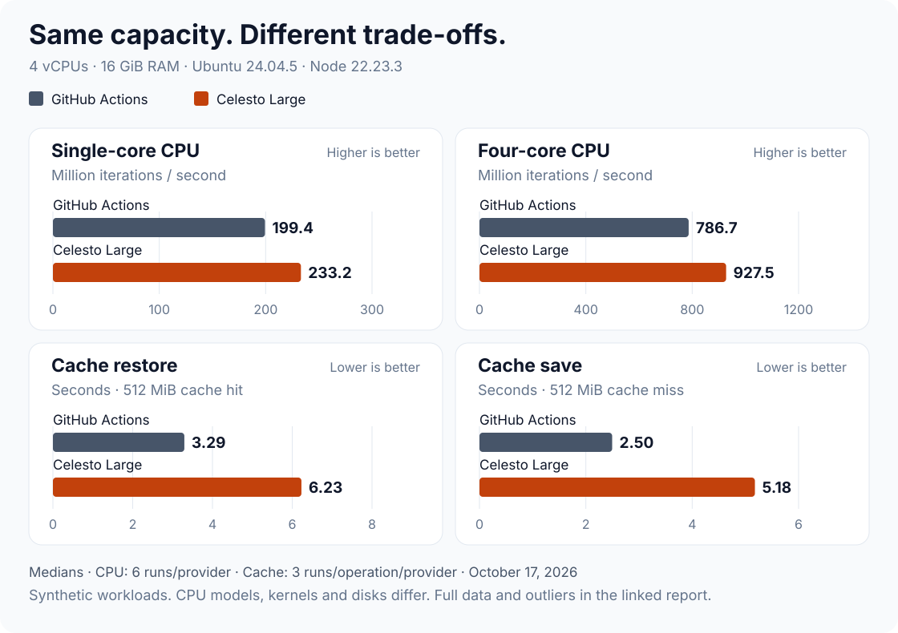

# CI benchmarks

**Compare Celesto CI and GitHub Actions on CPU speed and cache performance.** Same benchmark, same CPU count, same RAM. Runs and raw data are public.

[CPU/cache results](results/2026-10-17-matched/README.md) · [Docker results](results/docker-2026-10-17/README.md) · [Run the CPU comparison](https://github.com/CelestoAI/ci-benchmarks/actions/workflows/matched.yml)

## Docker benchmarks

**Python API + PostgreSQL + Azurite, image builds, layer caches, and offline Rust compilation.** Five repetitions per provider/scenario, matched 4-vCPU / 16-GiB runners, fresh runner per job.

[See Docker numbers and plot →](results/docker-2026-10-17/README.md) · [Workloads and reproduction →](docker-bench/README.md)

Read the caveats before migrating: direct BuildKit GHA caching and Docker's explicit CPU-limit flag failed Celesto preflight. The report preserves a quota-limited run separately from the normal-operation rerun. These fixtures are not the customer's private application.

## CPU/cache results

October 17, 2026. Both runners: **4 vCPUs, 16 GiB RAM, Ubuntu 24.04.5, Node 22.23.3**. Three cold/warm pairs per provider; all 12 jobs passed.

[](results/2026-10-17-matched/README.md)

| Measurement | GitHub Actions | Celesto Large | Better |
| --- | ---: | ---: | --- |
| Single-core CPU ↑ | 199.4 million iterations/s | 233.2 million iterations/s | Celesto +16.9% |
| Four-core CPU ↑ | 786.7 million iterations/s | 927.5 million iterations/s | Celesto +17.9% |
| Restore a 512 MiB cache ↓ | 3.30 s | 6.23 s | GitHub 1.89× faster |
| Save a 512 MiB cache ↓ | 2.50 s | 5.18 s | GitHub 2.08× faster |

↑ More work per second is better. ↓ Less time is better. Values are medians: six CPU measurements and three measurements per cache operation, per provider.

**In this test:** Celesto had higher median CPU throughput. GitHub saved and restored the cache faster. CPU models, kernels, and disks differed despite matching CPU/RAM capacity. These are synthetic workloads, not a prediction for every build.

[Full methodology, ranges, outliers, and raw data →](results/2026-10-17-matched/README.md)

## Run it yourself

No local install needed. One workflow runs both providers and produces all 12 jobs.

1. **Use a repo you can run workflows in.** If you do not have write access here, [fork this repo](https://github.com/CelestoAI/ci-benchmarks/fork) and enable **Actions** in your fork.
2. **Connect Celesto.** [Install the Celesto CI App](https://github.com/apps/celesto-ci) for that repo and connect it to a Celesto workspace. It needs credit eligible for the **Large** runner; a Micro-only trial will not work. Celesto jobs consume workspace credit.
3. **Open Actions → Matched 4-core benchmark → Run workflow.** Use `main`. In a fork, open this workflow from your fork's Actions tab.
4. **Change `cache_namespace` to a new name**, such as `yourname-test-001`, then click **Run workflow**. Use a different name for every new experiment. Do not reuse the prefilled name.

That's it. The workflow handles the order:

| Phase | What happens | Expected cache result |
| --- | --- | --- |
| Cold | Create and save a new cache on each provider | `false` (miss) |
| Warm | Restore the cache saved by the cold run | `true` (hit) |

Each phase has three samples per provider. The reference experiment finished in **5m 33s**; runner startup and queues can change the wait.

## Find your numbers

Open the completed run in **Actions**:

- **Summary:** scroll down for each job's CPU throughput, cache hit, restore time, and save time.
- **Artifacts:** download a job's archive. `benchmark-summary.md` is the readable report; `benchmark-events.jsonl` contains raw timings and machine details.
- **Success check:** all 12 jobs should pass. Cold jobs should miss; warm jobs should hit. Save time is absent on warm runs because an existing cache is reused.

The workflow does not calculate a cross-provider median for you. The [published report](results/2026-10-17-matched/README.md) shows how this experiment was summarized.

## Something stuck?

| Symptom | What to check |
| --- | --- |
| No **Run workflow** button | You need write access. In a fork, enable Actions first. |
| Celesto job stays queued | Open the commit's **Celesto runner setup** check. Verify App access, workspace connection, and credit eligible for Large. |
| A cold job reports a hit | The namespace was used before. Start a new experiment with a new name. |
| A warm job misses | Check the matching cold job's cache-save logs. Warm runs need that saved cache. |
| CPU/RAM check fails | Both providers must expose four CPUs and at least 14 GiB usable RAM. Check the selected runner and job logs. |

[Report a problem](https://github.com/CelestoAI/ci-benchmarks/issues/new). Include the run URL, job name, and relevant error.

## How the test works

The [matched workflow](.github/workflows/matched.yml) calls the [same benchmark steps](.github/workflows/benchmark.yml) for both providers.

- **CPU:** two billion integer-mixing iterations per worker. Run once with one worker and once with four.
- **Cache:** 512 MiB of random bytes that do not compress well. Each provider has its own cache store.
- **Timing:** restore/save measurements include action overhead, transfer, and compression or extraction. They do not measure network speed alone.
- **Elapsed time:** the report's instrumented time excludes checkout, Node setup, queueing, and artifact upload. Use the Actions UI for total workflow time.

Want a different random-byte payload? Use the individual [GitHub](.github/workflows/github-hosted.yml) and [Celesto](.github/workflows/celesto-cpu.yml) CPU/cache workflows. Match their inputs; run each once cold, then again unchanged for warm. Payload options: 256, 512, 1024, or 2304 MiB. `celesto.yml` is now the Docker dispatcher; the original individual Celesto CPU workflow is preserved as `celesto-cpu.yml`.

Regenerate the chart from the saved samples with `node scripts/render-chart.mjs`.

Inspired by [Celesto's dependency-cache post](https://celesto.ai/blog/posts/celesto-ci-dependency-cache/). This repo uses a synthetic random-byte cache, so it does not reproduce that post's dependency workload.

## Try the scripts locally

Requires **Node.js 20+** and a macOS, Linux, or WSL shell. No `npm install` needed. These commands are a quick script check; provider cache timing requires CI.

```sh
git clone https://github.com/CelestoAI/ci-benchmarks.git
cd ci-benchmarks
BENCHMARK_CPU_ITERATIONS=1000000 node scripts/cpu-benchmark.mjs
BENCHMARK_CACHE_MIB=16 node scripts/seed-cache.mjs
```

Expect `CPU benchmark: … iterations/s` and `Generated 16 MiB cache payload…`. The scripts write `benchmark-events.jsonl` and `.benchmark-cache/` locally.
