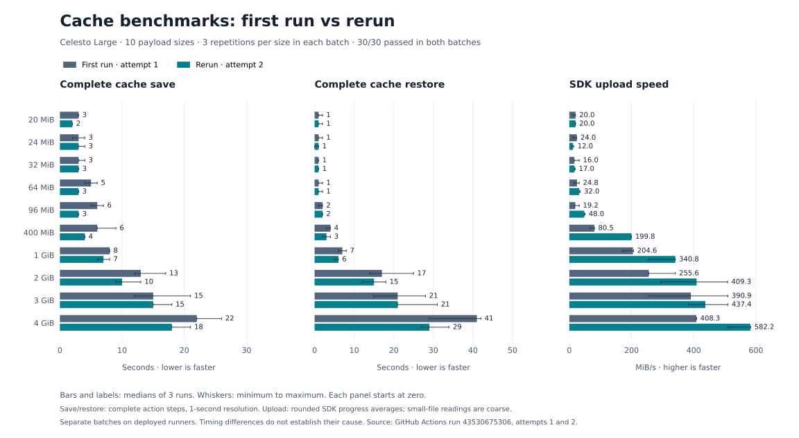

# Cache size matrix

[Cache size matrix](../.github/workflows/cache-size-matrix.yml) extends the
existing native cache benchmark to the payload sizes discussed in
[backend PR #1284](https://github.com/CelestoAI/backend/pull/1284):
20, 24, 32, 64, 96 and 400 MiB, and 1, 2, 3 and 4 GiB. Each size runs three
times on a fresh Celesto Large runner. Jobs run sequentially within the sweep;
other workflows can still compete for the same capacity.

[November 14 rerun, attempt 2](../results/cache-size-matrix-2026-11-14-attempt-2/README.md):
all 30 roundtrips passed, with per-size medians, upload speeds and a comparison
with the [first batch](../results/cache-size-matrix-2026-11-14/README.md).

The paired bars show each batch's three-run medians, with minimum-to-maximum
whiskers. [View the comparison and exact values](../results/cache-size-matrix-2026-11-14-attempt-2/README.md#first-run-vs-rerun).

The workflow generates one random, incompressible file, saves it with the same
pinned `actions/cache` v6.1.0 as the original 4 GiB benchmark, hashes and deletes
the input, restores the exact cache key, and requires matching size and SHA-256.
Hashing happens after save so it does not add a read before the timed save.
Keys include the run ID, attempt, size and repetition. No upload chunk or
concurrency overrides are applied.

These are **payload sizes**, not exact compressed archive sizes. Tar and zstd
add overhead, so a 24 MiB payload can produce an archive above the PR's 24 MiB
single-PUT threshold. This benchmark measures the deployed runner image; it
does not install or qualify the unmerged backend patch.

Run **Cache size matrix** from Actions on a branch containing the workflow.
Its initial experiment branch also runs it when the workflow file is pushed.
The workflow is manual, with no recurring schedule. Avoid running other suites
at the same time when possible.

Artifacts, retained for 14 days:

- `integrity-<size>mib-<repetition>`: host fingerprint, original and restored
  hashes, and `verification.json` with payload bytes, cache key and action SHA.
- `results-cache-size-matrix`: every job's queue, save, restore and verification
  step times from the GitHub Jobs API, including failed jobs.

Times have one-second resolution. Save and restore cover their complete action
steps, including compression/extraction and action startup. Verification is
reported separately; exclude it when comparing save-plus-restore totals. Small
payload timings should be read with the one-second resolution in mind.
Queue times include the intentional matrix serialization and should not be used
to compare provider provisioning latency.

The size matrix uses a separate workflow and artifact name so it does not mix
small payloads into the existing published 4 GiB, 30-day provider comparison.
The native provider cache applies its normal retention policy to these keys.
