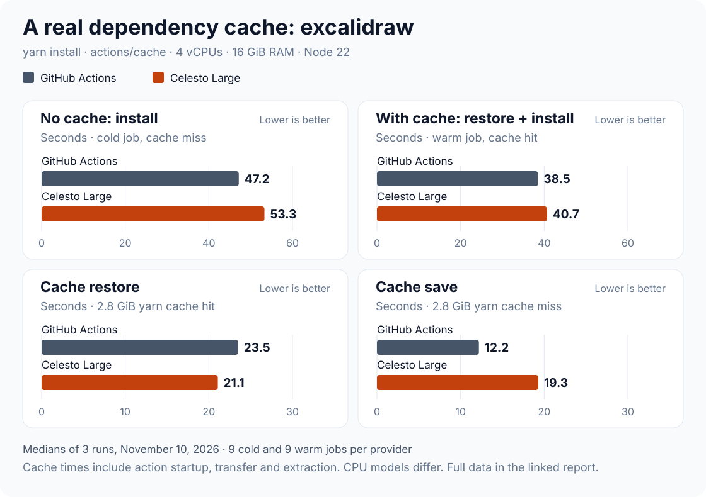

# Real-repo dependency cache: excalidraw, November 10, 2026

Three runs of the [real-repo dependency cache benchmark](../../.github/workflows/deps-real-repo.yml): [42738260866](https://github.com/CelestoAI/ci-benchmarks/actions/runs/42738260866), [42738598606](https://github.com/CelestoAI/ci-benchmarks/actions/runs/42738598606) and [42738998445](https://github.com/CelestoAI/ci-benchmarks/actions/runs/42738998445). The runs went one after another.

## Setup

- **Workload:** [excalidraw/excalidraw](https://github.com/excalidraw/excalidraw) at `701b901`, yarn 1.22.22, a 470 KiB `yarn.lock`. Each job runs `yarn install --frozen-lockfile --prefer-offline`.
- **Cache:** `actions/cache` of the yarn cache folder (2.8 GiB). This is what `setup-node` with `cache: yarn` does. `node_modules` is not cached.
- **Runners:** GitHub `ubuntu-24.04` versus Celesto `celesto-large`: 4 vCPUs, 16 GiB RAM, Node 22.
- **Phases:** a cold job installs with an empty cache and saves it. A warm job restores that save and installs again. Each run has three cold/warm pairs per provider, each with its own key, so the three runs give 36 jobs. All 36 passed. All 18 cold jobs missed and all 18 warm jobs hit.

## Result

| Median | GitHub Actions | Celesto Large | Better |
| --- | ---: | ---: | --- |
| No cache: install ↓ | 47.2 s | 53.3 s | GitHub 1.13× faster |
| With cache: restore + install ↓ | 38.5 s | 40.7 s | GitHub 1.06× faster |
| Restore the 2.8 GiB cache ↓ | 23.5 s | 21.1 s | Celesto 1.12× faster |
| Install after the restore ↓ | 15.7 s | 20.0 s | GitHub 1.27× faster |
| Save the 2.8 GiB cache ↓ | 12.2 s | 19.3 s | GitHub 1.58× faster |

| Range | GitHub Actions | Celesto Large |
| --- | ---: | ---: |
| No cache: install | 36.6–49.3 s | 32.4–62.1 s |
| With cache: restore + install | 29.3–44.4 s | 24.6–85.2 s |
| Restore | 15.3–29.2 s | 14.1–31.9 s |
| Install after the restore | 14.0–19.9 s | 10.5–53.4 s |
| Save | 9.1–13.4 s | 16.2–23.3 s |

### The cache saves little on this repo

The yarn cache is 2.8 GiB. A warm job spends about 20 s restoring it to cut the install from about 50 s to 16–20 s. The net gain is 8.6 s on GitHub (18%) and 12.6 s on Celesto (24%). The cold save adds 12–19 s to every job that misses.

### Celesto ran on two CPU models

Celesto ran 12 jobs on AMD EPYC-Milan and 6 on Intel Xeon Platinum 8375C. The Intel jobs installed faster: cold median 35.6 s versus 56.7 s on Milan. One Intel warm job took 53.4 s to install, the slowest warm install in the report. GitHub ran jobs on EPYC 7763, 9V45, 9V74 and Xeon 6973P-C.

## Limits

- One repository, one package manager (yarn 1) and one cache layout. A `node_modules` cache or a smaller lockfile can give a different answer.
- Cold installs download packages from the npm registry, so network speed to the registry is part of the cold time.
- Cache times include action startup, transfer, compression and extraction.
- CPU models, kernels and disks differ between and within providers.

## Per-job evidence

| Run | Provider | State | Sample | CPU | Hit | Restore s | Install s | Save s | Job |
| --- | --- | --- | ---: | --- | --- | ---: | ---: | ---: | --- |
| 42738260866 | celesto-large | cold | 1 | AMD EPYC-Milan |  | 0.273 | 52.895 | 19.567 | [logs](https://github.com/CelestoAI/ci-benchmarks/actions/runs/42738260866/job/129572719961) |
| 42738260866 | celesto-large | warm | 1 | AMD EPYC-Milan | true | 18.318 | 22.929 | skipped | [logs](https://github.com/CelestoAI/ci-benchmarks/actions/runs/42738260866/job/129573282960) |
| 42738260866 | celesto-large | cold | 2 | Intel Xeon Platinum 8375C |  | 0.299 | 35.582 | 18.951 | [logs](https://github.com/CelestoAI/ci-benchmarks/actions/runs/42738260866/job/129572719864) |
| 42738260866 | celesto-large | warm | 2 | AMD EPYC-Milan | true | 21.073 | 18.394 | skipped | [logs](https://github.com/CelestoAI/ci-benchmarks/actions/runs/42738260866/job/129573282870) |
| 42738260866 | celesto-large | cold | 3 | AMD EPYC-Milan |  | 0.334 | 53.870 | 16.847 | [logs](https://github.com/CelestoAI/ci-benchmarks/actions/runs/42738260866/job/129572720150) |
| 42738260866 | celesto-large | warm | 3 | Intel Xeon Platinum 8375C | true | 14.100 | 10.493 | skipped | [logs](https://github.com/CelestoAI/ci-benchmarks/actions/runs/42738260866/job/129573282734) |
| 42738260866 | github-hosted | cold | 1 | AMD EPYC 7763 64-Core |  | 0.385 | 48.163 | 13.389 | [logs](https://github.com/CelestoAI/ci-benchmarks/actions/runs/42738260866/job/129572720145) |
| 42738260866 | github-hosted | warm | 1 | AMD EPYC 9V74 80-Core | true | 24.520 | 19.895 | skipped | [logs](https://github.com/CelestoAI/ci-benchmarks/actions/runs/42738260866/job/129573282830) |
| 42738260866 | github-hosted | cold | 2 | AMD EPYC 9V45 96-Core |  | 0.343 | 37.805 | 10.619 | [logs](https://github.com/CelestoAI/ci-benchmarks/actions/runs/42738260866/job/129572719715) |
| 42738260866 | github-hosted | warm | 2 | AMD EPYC 7763 64-Core | true | 15.282 | 14.024 | skipped | [logs](https://github.com/CelestoAI/ci-benchmarks/actions/runs/42738260866/job/129573282856) |
| 42738260866 | github-hosted | cold | 3 | AMD EPYC 7763 64-Core |  | 0.213 | 49.115 | 12.596 | [logs](https://github.com/CelestoAI/ci-benchmarks/actions/runs/42738260866/job/129572719908) |
| 42738260866 | github-hosted | warm | 3 | AMD EPYC 9V45 96-Core | true | 29.169 | 14.778 | skipped | [logs](https://github.com/CelestoAI/ci-benchmarks/actions/runs/42738260866/job/129573282632) |
| 42738598606 | celesto-large | cold | 1 | AMD EPYC-Milan |  | 0.353 | 52.941 | 16.234 | [logs](https://github.com/CelestoAI/ci-benchmarks/actions/runs/42738598606/job/129573821554) |
| 42738598606 | celesto-large | warm | 1 | AMD EPYC-Milan | true | 22.323 | 27.943 | skipped | [logs](https://github.com/CelestoAI/ci-benchmarks/actions/runs/42738598606/job/129574421752) |
| 42738598606 | celesto-large | cold | 2 | Intel Xeon Platinum 8375C |  | 0.268 | 32.131 | 19.297 | [logs](https://github.com/CelestoAI/ci-benchmarks/actions/runs/42738598606/job/129573821316) |
| 42738598606 | celesto-large | warm | 2 | AMD EPYC-Milan | true | 24.804 | 27.160 | skipped | [logs](https://github.com/CelestoAI/ci-benchmarks/actions/runs/42738598606/job/129574421636) |
| 42738598606 | celesto-large | cold | 3 | AMD EPYC-Milan |  | 0.358 | 59.583 | 17.379 | [logs](https://github.com/CelestoAI/ci-benchmarks/actions/runs/42738598606/job/129573821479) |
| 42738598606 | celesto-large | warm | 3 | Intel Xeon Platinum 8375C | true | 31.854 | 53.387 | skipped | [logs](https://github.com/CelestoAI/ci-benchmarks/actions/runs/42738598606/job/129574421692) |
| 42738598606 | github-hosted | cold | 1 | AMD EPYC 9V45 96-Core |  | 0.293 | 39.384 | 9.119 | [logs](https://github.com/CelestoAI/ci-benchmarks/actions/runs/42738598606/job/129573821470) |
| 42738598606 | github-hosted | warm | 1 | AMD EPYC 7763 64-Core | true | 23.499 | 15.013 | skipped | [logs](https://github.com/CelestoAI/ci-benchmarks/actions/runs/42738598606/job/129574421728) |
| 42738598606 | github-hosted | cold | 2 | AMD EPYC 9V45 96-Core |  | 0.209 | 36.395 | 13.396 | [logs](https://github.com/CelestoAI/ci-benchmarks/actions/runs/42738598606/job/129573821546) |
| 42738598606 | github-hosted | warm | 2 | AMD EPYC 7763 64-Core | true | 19.212 | 14.790 | skipped | [logs](https://github.com/CelestoAI/ci-benchmarks/actions/runs/42738598606/job/129574421652) |
| 42738598606 | github-hosted | cold | 3 | AMD EPYC 7763 64-Core |  | 0.260 | 47.683 | 12.684 | [logs](https://github.com/CelestoAI/ci-benchmarks/actions/runs/42738598606/job/129573821551) |
| 42738598606 | github-hosted | warm | 3 | Intel Xeon 6973P-C | true | 26.178 | 16.512 | skipped | [logs](https://github.com/CelestoAI/ci-benchmarks/actions/runs/42738598606/job/129574421741) |
| 42738998445 | celesto-large | cold | 1 | Intel Xeon Platinum 8375C |  | 0.304 | 36.562 | 19.428 | [logs](https://github.com/CelestoAI/ci-benchmarks/actions/runs/42738998445/job/129575127666) |
| 42738998445 | celesto-large | warm | 1 | AMD EPYC-Milan | true | 21.582 | 19.098 | skipped | [logs](https://github.com/CelestoAI/ci-benchmarks/actions/runs/42738998445/job/129575780574) |
| 42738998445 | celesto-large | cold | 2 | AMD EPYC-Milan |  | 0.324 | 59.774 | 19.923 | [logs](https://github.com/CelestoAI/ci-benchmarks/actions/runs/42738998445/job/129575127689) |
| 42738998445 | celesto-large | warm | 2 | Intel Xeon Platinum 8375C | true | 20.226 | 12.144 | skipped | [logs](https://github.com/CelestoAI/ci-benchmarks/actions/runs/42738998445/job/129575780644) |
| 42738998445 | celesto-large | cold | 3 | AMD EPYC-Milan |  | 0.365 | 61.781 | 23.335 | [logs](https://github.com/CelestoAI/ci-benchmarks/actions/runs/42738998445/job/129575127765) |
| 42738998445 | celesto-large | warm | 3 | AMD EPYC-Milan | true | 17.711 | 19.996 | skipped | [logs](https://github.com/CelestoAI/ci-benchmarks/actions/runs/42738998445/job/129575780684) |
| 42738998445 | github-hosted | cold | 1 | AMD EPYC 9V45 96-Core |  | 0.237 | 39.346 | 9.631 | [logs](https://github.com/CelestoAI/ci-benchmarks/actions/runs/42738998445/job/129575127677) |
| 42738998445 | github-hosted | warm | 1 | AMD EPYC 9V74 80-Core | true | 24.425 | 16.040 | skipped | [logs](https://github.com/CelestoAI/ci-benchmarks/actions/runs/42738998445/job/129575780620) |
| 42738998445 | github-hosted | cold | 2 | AMD EPYC 7763 64-Core |  | 0.212 | 47.777 | 12.191 | [logs](https://github.com/CelestoAI/ci-benchmarks/actions/runs/42738998445/job/129575127408) |
| 42738998445 | github-hosted | warm | 2 | AMD EPYC 9V74 80-Core | true | 18.540 | 16.212 | skipped | [logs](https://github.com/CelestoAI/ci-benchmarks/actions/runs/42738998445/job/129575780534) |
| 42738998445 | github-hosted | cold | 3 | AMD EPYC 7763 64-Core |  | 0.226 | 46.930 | 11.788 | [logs](https://github.com/CelestoAI/ci-benchmarks/actions/runs/42738998445/job/129575127743) |
| 42738998445 | github-hosted | warm | 3 | AMD EPYC 9V74 80-Core | true | 21.248 | 15.714 | skipped | [logs](https://github.com/CelestoAI/ci-benchmarks/actions/runs/42738998445/job/129575780673) |

Raw values: [samples.json](samples.json). Regenerate the chart with `node scripts/render-deps-chart.mjs`.
