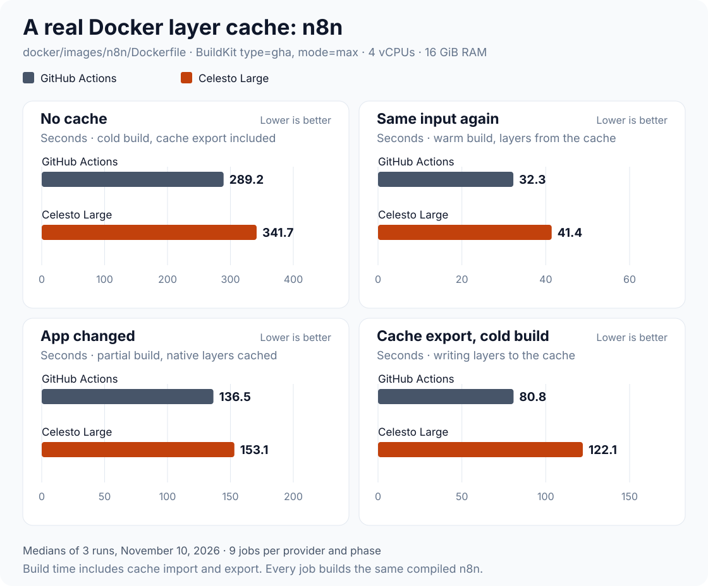

# Real-repo Docker layer cache: n8n, November 10, 2026

Three runs of the [real-repo Docker layer cache benchmark](../../.github/workflows/docker-real-repo.yml): [42842966842](https://github.com/CelestoAI/ci-benchmarks/actions/runs/42842966842), [42847912840](https://github.com/CelestoAI/ci-benchmarks/actions/runs/42847912840) and [42852263141](https://github.com/CelestoAI/ci-benchmarks/actions/runs/42852263141). The runs went one after another.

## Setup

- **Workload:** [n8n-io/n8n](https://github.com/n8n-io/n8n) at `f8a6d13`, built from `docker/images/n8n/Dockerfile` with the base images pinned in n8n's `docker/docker-bake.hcl`. The image compiles three native Node modules (isolated-vm, sqlite3, Kafka) and copies the compiled app.
- **Same input for every job:** n8n's image needs the app compiled first. A prepare job on GitHub runs n8n's own build script (`pnpm install`, `turbo build`, `pnpm deploy`) once per run and passes the build context to every job as an artifact. Both providers build from the same bytes.
- **Cache:** BuildKit `type=gha`, `mode=max`, one scope per run and sample. On Celesto the same settings go to Celesto's cache with no workflow change.
- **Runners:** GitHub `ubuntu-24.04` versus Celesto `celesto-large`, 4 vCPUs and 16 GiB RAM.
- **Phases:** a cold build starts with an empty cache and exports it. A warm build uses the same input again. A partial build adds one file to the app: the native-module layers should come from the cache and the app layers rebuild.
- **Jobs:** 3 samples per provider and phase, so each run has 18 build jobs plus the prepare job. All 57 jobs passed.

## Result

Build time is the whole `docker buildx build`, including cache import and export.

| Median | GitHub Actions | Celesto Large | Better |
| --- | ---: | ---: | --- |
| No cache ↓ | 289.2 s | 341.7 s | GitHub 1.18× faster |
| Same input again ↓ | 32.3 s | 41.4 s | GitHub 1.28× faster |
| App changed ↓ | 136.5 s | 153.1 s | GitHub 1.12× faster |
| Cache export, cold build ↓ | 80.8 s | 122.1 s | GitHub 1.51× faster |

| Range | GitHub Actions | Celesto Large |
| --- | ---: | ---: |
| No cache | 249.2–334.8 s | 306.2–351.4 s |
| Same input again | 23.8–36.1 s | 34.5–259.1 s |
| App changed | 106.5–145.9 s | 108.7–291.6 s |
| Cache export, cold build | 66.2–96.5 s | 105.7–139.0 s |

### The cache works on both providers

A warm build is about 89% faster than a cold one on both: 289 → 32 s on GitHub, 342 → 41 s on Celesto. When the app changes, the native-module compile (about 2.5 minutes) comes from the cache and only the app layers rebuild.

### Celesto writes the cache slower

Celesto's cold-build gap is the cache export: 122 s against 81 s. Without the export, cold builds took a median 210 s on Celesto and 214 s on GitHub, so the build itself is as fast. On warm builds Celesto spends about 10 s re-exporting the cache manifest against GitHub's 4 s.

### Two Celesto builds read a cache with missing layers

In run 42847912840, one warm and one partial Celesto build got a cache manifest that pointed at layers Celesto did not have. BuildKit marked those steps `CACHED`, then failed with `ERROR: blob sha256:…: not found` and rebuilt them. The two builds took 259 s and 292 s instead of about 41 s and 150 s. No GitHub build had this.

Four layers were missing, all written by cold builds at 15:56 UTC. Celesto's server logs show two of those saves failing:

| Missing layer | Written by | Server log |
| --- | --- | --- |
| `cfd62185…` | cold s3, 15:56:09–10 | save refused `too_slow` at 15:56:10.9 |
| `d3f3ac55…` | cold s3, 15:56:11–15 | finalize refused `upload_missing` at 15:56:15.2 |
| `b0abdf84…` | cold s3, 15:56:05–07 | no failure logged |
| `9ed384de…` | cold s1, 15:56:38–39 | no failure logged |

Celesto answers a refused save with `already_exists`, which BuildKit reads as "this layer is already stored". BuildKit then records the layer in its manifest even though it was never saved. Why the other two layers are missing is not known.

## Limits

- One Dockerfile. n8n's build is dominated by native compiles and one large app layer; other images can give a different answer.
- Medians include the two slow Celesto builds. No sample was removed.
- CPU models differ. Celesto ran jobs on AMD EPYC-Milan (18) and Intel Xeon Platinum 8375C (9). GitHub ran jobs on five models, mostly AMD EPYC 7763.
- The prepare job always runs on GitHub, so n8n's own compile time is not part of this comparison.

## Per-job evidence

| Run | Provider | State | Sample | CPU | Build s | Export s | CACHED steps | Missing layers | Job |
| --- | --- | --- | ---: | --- | ---: | ---: | ---: | ---: | --- |
| 42842966842 | celesto-large | cold | 1 | AMD EPYC-Milan | 345.71 | 122.1 | 0/26 | 0 | [logs](https://github.com/CelestoAI/ci-benchmarks/actions/runs/42842966842/job/129925368039) |
| 42842966842 | celesto-large | warm | 1 | AMD EPYC-Milan | 41.413 | 10.4 | 26/26 | 0 | [logs](https://github.com/CelestoAI/ci-benchmarks/actions/runs/42842966842/job/129929778428) |
| 42842966842 | celesto-large | partial | 1 | AMD EPYC-Milan | 153.145 | 73.3 | 20/26 | 0 | [logs](https://github.com/CelestoAI/ci-benchmarks/actions/runs/42842966842/job/129931066979) |
| 42842966842 | celesto-large | cold | 2 | Intel Xeon Platinum 8375C | 345.696 | 123.2 | 0/26 | 0 | [logs](https://github.com/CelestoAI/ci-benchmarks/actions/runs/42842966842/job/129925368360) |
| 42842966842 | celesto-large | warm | 2 | Intel Xeon Platinum 8375C | 42.594 | 9.5 | 26/26 | 0 | [logs](https://github.com/CelestoAI/ci-benchmarks/actions/runs/42842966842/job/129929778543) |
| 42842966842 | celesto-large | partial | 2 | Intel Xeon Platinum 8375C | 121.226 | 65.3 | 20/26 | 0 | [logs](https://github.com/CelestoAI/ci-benchmarks/actions/runs/42842966842/job/129931067130) |
| 42842966842 | celesto-large | cold | 3 | AMD EPYC-Milan | 348.826 | 139 | 0/26 | 0 | [logs](https://github.com/CelestoAI/ci-benchmarks/actions/runs/42842966842/job/129925368413) |
| 42842966842 | celesto-large | warm | 3 | AMD EPYC-Milan | 40.419 | 10.6 | 26/26 | 0 | [logs](https://github.com/CelestoAI/ci-benchmarks/actions/runs/42842966842/job/129929778421) |
| 42842966842 | celesto-large | partial | 3 | AMD EPYC-Milan | 172.672 | 63.9 | 20/26 | 0 | [logs](https://github.com/CelestoAI/ci-benchmarks/actions/runs/42842966842/job/129931067041) |
| 42842966842 | github-hosted | cold | 1 | AMD EPYC 9V74 80-Core | 267.668 | 66.2 | 0/26 | 0 | [logs](https://github.com/CelestoAI/ci-benchmarks/actions/runs/42842966842/job/129925368445) |
| 42842966842 | github-hosted | warm | 1 | AMD EPYC 9V74 80-Core | 29.14 | 2.1 | 26/26 | 0 | [logs](https://github.com/CelestoAI/ci-benchmarks/actions/runs/42842966842/job/129929778478) |
| 42842966842 | github-hosted | partial | 1 | AMD EPYC 9V45 96-Core | 106.518 | 49.1 | 20/26 | 0 | [logs](https://github.com/CelestoAI/ci-benchmarks/actions/runs/42842966842/job/129931066891) |
| 42842966842 | github-hosted | cold | 2 | AMD EPYC 7763 64-Core | 334.781 | 87.8 | 0/26 | 0 | [logs](https://github.com/CelestoAI/ci-benchmarks/actions/runs/42842966842/job/129925368117) |
| 42842966842 | github-hosted | warm | 2 | AMD EPYC 7763 64-Core | 33.34 | 2.1 | 26/26 | 0 | [logs](https://github.com/CelestoAI/ci-benchmarks/actions/runs/42842966842/job/129929778429) |
| 42842966842 | github-hosted | partial | 2 | AMD EPYC 7763 64-Core | 134.339 | 59.6 | 20/26 | 0 | [logs](https://github.com/CelestoAI/ci-benchmarks/actions/runs/42842966842/job/129931067109) |
| 42842966842 | github-hosted | cold | 3 | AMD EPYC 9V45 96-Core | 249.211 | 87.9 | 0/26 | 0 | [logs](https://github.com/CelestoAI/ci-benchmarks/actions/runs/42842966842/job/129925368177) |
| 42842966842 | github-hosted | warm | 3 | AMD EPYC 7763 64-Core | 35.157 | 4.6 | 26/26 | 0 | [logs](https://github.com/CelestoAI/ci-benchmarks/actions/runs/42842966842/job/129929778296) |
| 42842966842 | github-hosted | partial | 3 | AMD EPYC 7763 64-Core | 122.562 | 48 | 20/26 | 0 | [logs](https://github.com/CelestoAI/ci-benchmarks/actions/runs/42842966842/job/129931066943) |
| 42847912840 | celesto-large | cold | 1 | AMD EPYC-Milan | 341.682 | 120.8 | 0/26 | 0 | [logs](https://github.com/CelestoAI/ci-benchmarks/actions/runs/42847912840/job/129942696807) |
| 42847912840 | celesto-large | warm | 1 | Intel Xeon Platinum 8375C | 67.917 | 9.6 | 26/26 | 0 | [logs](https://github.com/CelestoAI/ci-benchmarks/actions/runs/42847912840/job/129946760019) |
| 42847912840 | celesto-large | partial | 1 | Intel Xeon Platinum 8375C | 291.62 | 70.1 | 19/26 | 1 | [logs](https://github.com/CelestoAI/ci-benchmarks/actions/runs/42847912840/job/129949789695) |
| 42847912840 | celesto-large | cold | 2 | AMD EPYC-Milan | 333.984 | 127.4 | 0/26 | 0 | [logs](https://github.com/CelestoAI/ci-benchmarks/actions/runs/42847912840/job/129942697926) |
| 42847912840 | celesto-large | warm | 2 | AMD EPYC-Milan | 42.314 | 10.9 | 26/26 | 0 | [logs](https://github.com/CelestoAI/ci-benchmarks/actions/runs/42847912840/job/129946766041) |
| 42847912840 | celesto-large | partial | 2 | AMD EPYC-Milan | 155.805 | 67.1 | 20/26 | 0 | [logs](https://github.com/CelestoAI/ci-benchmarks/actions/runs/42847912840/job/129949789776) |
| 42847912840 | celesto-large | cold | 3 | Intel Xeon Platinum 8375C | 315.904 | 129 | 0/26 | 0 | [logs](https://github.com/CelestoAI/ci-benchmarks/actions/runs/42847912840/job/129942696602) |
| 42847912840 | celesto-large | warm | 3 | AMD EPYC-Milan | 259.059 | 45.5 | 25/26 | 3 | [logs](https://github.com/CelestoAI/ci-benchmarks/actions/runs/42847912840/job/129946760522) |
| 42847912840 | celesto-large | partial | 3 | AMD EPYC-Milan | 191.591 | 66.4 | 20/26 | 0 | [logs](https://github.com/CelestoAI/ci-benchmarks/actions/runs/42847912840/job/129949789463) |
| 42847912840 | github-hosted | cold | 1 | AMD EPYC 7763 64-Core | 318.839 | 71.7 | 0/26 | 0 | [logs](https://github.com/CelestoAI/ci-benchmarks/actions/runs/42847912840/job/129942696648) |
| 42847912840 | github-hosted | warm | 1 | Intel Xeon Platinum 8370C | 23.759 | 2.1 | 26/26 | 0 | [logs](https://github.com/CelestoAI/ci-benchmarks/actions/runs/42847912840/job/129946762735) |
| 42847912840 | github-hosted | partial | 1 | AMD EPYC 7763 64-Core | 141.181 | 64.1 | 20/26 | 0 | [logs](https://github.com/CelestoAI/ci-benchmarks/actions/runs/42847912840/job/129949789466) |
| 42847912840 | github-hosted | cold | 2 | Intel Xeon Platinum 8370C | 288.241 | 74.6 | 0/26 | 0 | [logs](https://github.com/CelestoAI/ci-benchmarks/actions/runs/42847912840/job/129942696627) |
| 42847912840 | github-hosted | warm | 2 | AMD EPYC 7763 64-Core | 36.065 | 4.6 | 26/26 | 0 | [logs](https://github.com/CelestoAI/ci-benchmarks/actions/runs/42847912840/job/129946761959) |
| 42847912840 | github-hosted | partial | 2 | AMD EPYC 7763 64-Core | 145.878 | 69.7 | 20/26 | 0 | [logs](https://github.com/CelestoAI/ci-benchmarks/actions/runs/42847912840/job/129949789605) |
| 42847912840 | github-hosted | cold | 3 | AMD EPYC 9V45 96-Core | 251.045 | 85.1 | 0/26 | 0 | [logs](https://github.com/CelestoAI/ci-benchmarks/actions/runs/42847912840/job/129942698105) |
| 42847912840 | github-hosted | warm | 3 | AMD EPYC 9V74 80-Core | 30.751 | 3.8 | 26/26 | 0 | [logs](https://github.com/CelestoAI/ci-benchmarks/actions/runs/42847912840/job/129946762447) |
| 42847912840 | github-hosted | partial | 3 | AMD EPYC 9V74 80-Core | 138.754 | 62.1 | 20/26 | 0 | [logs](https://github.com/CelestoAI/ci-benchmarks/actions/runs/42847912840/job/129949789474) |
| 42852263141 | celesto-large | cold | 1 | AMD EPYC-Milan | 351.441 | 113.1 | 0/26 | 0 | [logs](https://github.com/CelestoAI/ci-benchmarks/actions/runs/42852263141/job/129958024017) |
| 42852263141 | celesto-large | warm | 1 | AMD EPYC-Milan | 40.426 | 11.8 | 26/26 | 0 | [logs](https://github.com/CelestoAI/ci-benchmarks/actions/runs/42852263141/job/129962130802) |
| 42852263141 | celesto-large | partial | 1 | AMD EPYC-Milan | 139.456 | 62.3 | 20/26 | 0 | [logs](https://github.com/CelestoAI/ci-benchmarks/actions/runs/42852263141/job/129963172479) |
| 42852263141 | celesto-large | cold | 2 | Intel Xeon Platinum 8375C | 306.196 | 109 | 0/26 | 0 | [logs](https://github.com/CelestoAI/ci-benchmarks/actions/runs/42852263141/job/129958024002) |
| 42852263141 | celesto-large | warm | 2 | Intel Xeon Platinum 8375C | 34.47 | 9.2 | 26/26 | 0 | [logs](https://github.com/CelestoAI/ci-benchmarks/actions/runs/42852263141/job/129962130697) |
| 42852263141 | celesto-large | partial | 2 | Intel Xeon Platinum 8375C | 108.702 | 62.7 | 20/26 | 0 | [logs](https://github.com/CelestoAI/ci-benchmarks/actions/runs/42852263141/job/129963171809) |
| 42852263141 | celesto-large | cold | 3 | AMD EPYC-Milan | 306.216 | 105.7 | 0/26 | 0 | [logs](https://github.com/CelestoAI/ci-benchmarks/actions/runs/42852263141/job/129958023880) |
| 42852263141 | celesto-large | warm | 3 | AMD EPYC-Milan | 41.037 | 9.9 | 26/26 | 0 | [logs](https://github.com/CelestoAI/ci-benchmarks/actions/runs/42852263141/job/129962130477) |
| 42852263141 | celesto-large | partial | 3 | AMD EPYC-Milan | 136.173 | 60.2 | 20/26 | 0 | [logs](https://github.com/CelestoAI/ci-benchmarks/actions/runs/42852263141/job/129963172819) |
| 42852263141 | github-hosted | cold | 1 | Intel Xeon Platinum 8370C | 289.165 | 76.4 | 0/26 | 0 | [logs](https://github.com/CelestoAI/ci-benchmarks/actions/runs/42852263141/job/129958023923) |
| 42852263141 | github-hosted | warm | 1 | AMD EPYC 7763 64-Core | 35.257 | 4.5 | 26/26 | 0 | [logs](https://github.com/CelestoAI/ci-benchmarks/actions/runs/42852263141/job/129962130707) |
| 42852263141 | github-hosted | partial | 1 | Intel Xeon Platinum 8370C | 107.055 | 55.8 | 20/26 | 0 | [logs](https://github.com/CelestoAI/ci-benchmarks/actions/runs/42852263141/job/129963172006) |
| 42852263141 | github-hosted | cold | 2 | AMD EPYC 7763 64-Core | 329.683 | 80.8 | 0/26 | 0 | [logs](https://github.com/CelestoAI/ci-benchmarks/actions/runs/42852263141/job/129958024055) |
| 42852263141 | github-hosted | warm | 2 | INTEL XEON PLATINUM 8573C | 27.345 | 3.1 | 26/26 | 0 | [logs](https://github.com/CelestoAI/ci-benchmarks/actions/runs/42852263141/job/129962130459) |
| 42852263141 | github-hosted | partial | 2 | AMD EPYC 7763 64-Core | 145.029 | 68 | 20/26 | 0 | [logs](https://github.com/CelestoAI/ci-benchmarks/actions/runs/42852263141/job/129963173203) |
| 42852263141 | github-hosted | cold | 3 | INTEL XEON PLATINUM 8573C | 310.402 | 96.5 | 0/26 | 0 | [logs](https://github.com/CelestoAI/ci-benchmarks/actions/runs/42852263141/job/129958024068) |
| 42852263141 | github-hosted | warm | 3 | AMD EPYC 9V74 80-Core | 32.273 | 4.6 | 26/26 | 0 | [logs](https://github.com/CelestoAI/ci-benchmarks/actions/runs/42852263141/job/129962130558) |
| 42852263141 | github-hosted | partial | 3 | AMD EPYC 7763 64-Core | 136.48 | 59.5 | 20/26 | 0 | [logs](https://github.com/CelestoAI/ci-benchmarks/actions/runs/42852263141/job/129963172092) |

Raw values: [samples.json](samples.json). Each job's BuildKit log is in its run's artifacts. Regenerate the chart with `node scripts/render-real-repo-charts.mjs`.
