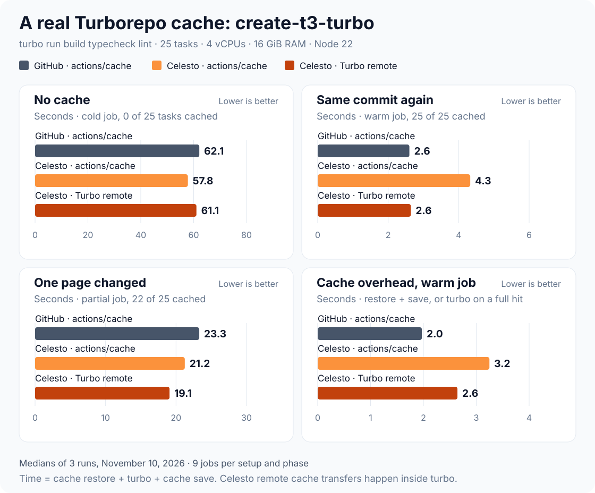

# Real-repo Turborepo cache: create-t3-turbo, November 10, 2026

Three runs of the [real-repo Turborepo cache benchmark](../../.github/workflows/turbo-real-repo.yml): [42843462452](https://github.com/CelestoAI/ci-benchmarks/actions/runs/42843462452), [42846373579](https://github.com/CelestoAI/ci-benchmarks/actions/runs/42846373579) and [42847124975](https://github.com/CelestoAI/ci-benchmarks/actions/runs/42847124975). The runs went one after another.

## Setup

- **Workload:** [t3-oss/create-t3-turbo](https://github.com/t3-oss/create-t3-turbo) at `8f945b7`, turbo 2.5.8, pnpm. Each job runs `turbo run build typecheck lint`: 25 tasks, including a Next.js build.
- **Three cache setups:**

  | Setup | Runner | How the Turbo cache is kept |
  | --- | --- | --- |
  | GitHub · actions/cache | `ubuntu-24.04` | `.turbo/cache` restored and saved with `actions/cache`; turbo runs with `--cache=local:rw` |
  | Celesto · actions/cache | `celesto-large` | The same steps; `actions/cache` goes to Celesto's cache |
  | Celesto · Turbo remote | `celesto-large` | Celesto's Turbo remote cache. The runner sets `TURBO_API`, `TURBO_TOKEN` and `TURBO_TEAM`; the workflow sets nothing and has no cache step |

- **Runners:** 4 vCPUs, 16 GiB RAM, Node 22.
- **Phases:** a cold job runs with an empty cache. A warm job runs the same commit again. A partial job adds one line to `apps/nextjs/src/app/page.tsx`, so the Next.js tasks rerun.
- **Isolation:** each run, setup and sample has its own cache key and its own Turbo task hashes (a unique value in `globalEnv`). Celesto's Turbo cache is shared by the whole repository, so without this a cold job could hit another job's uploads.
- **Jobs:** 3 samples per setup and phase, so each run has 27 jobs and the three runs 81. All 81 passed. Every cold job cached 0 of 25 tasks, every warm job 25 of 25, every partial job 22 of 25. Celesto Turbo remote jobs read all their hits from the remote cache.

## Result

Time is cache restore + `turbo run` + cache save. Celesto's Turbo remote cache has no separate steps; its downloads and uploads happen inside `turbo run`.

| Median | GitHub · actions/cache | Celesto · actions/cache | Celesto · Turbo remote |
| --- | ---: | ---: | ---: |
| No cache ↓ | 62.1 s | 57.8 s | 61.1 s |
| Same commit again ↓ | **2.6 s** | 4.3 s | **2.6 s** |
| One page changed ↓ | 23.3 s | 21.2 s | **19.1 s** |

| Warm job, median | GitHub · actions/cache | Celesto · actions/cache | Celesto · Turbo remote |
| --- | ---: | ---: | ---: |
| Restore `.turbo/cache` | 1.01 s | 1.04 s | — |
| `turbo run` (25 hits) | 1.07 s | 1.04 s | 2.64 s |
| Save `.turbo/cache` | 0.96 s | 2.06 s | — |

| Range | GitHub · actions/cache | Celesto · actions/cache | Celesto · Turbo remote |
| --- | ---: | ---: | ---: |
| No cache | 48.1–86.4 s | 50.7–92.7 s | 54.7–72.0 s |
| Same commit again | 2.1–4.5 s | 3.5–6.7 s | 2.1–3.9 s |
| One page changed | 17.9–26.4 s | 17.6–24.7 s | 18.4–24.3 s |

### The cache works on every setup

A warm run drops from about 60 s to 2.6–4.3 s, and a one-page change to 19–23 s. The local Turbo cache is small (about 8 MiB for a warm run), so transfer time is not the bottleneck; action startup and Celesto's save time are.

### Celesto's Turbo remote cache matches GitHub with no workflow change

On a warm run, Celesto's Turbo remote cache and GitHub with `actions/cache` both take a median 2.6 s. Celesto needs no cache step. With `actions/cache`, Celesto restores as fast as GitHub (1.04 s against 1.01 s) but saves about 2× slower (2.06 s against 0.96 s), the same pattern as the [synthetic cache test](../2026-11-02-matched/README.md).

### The partial lead is mostly CPU

On the one-page change, `turbo run` itself took 17.6 s on Celesto and 21.9 s on GitHub with the same `actions/cache` setup. The rebuilt Next.js task is CPU-bound, so this gap reflects the hardware, not the cache.

## Limits

- One small monorepo. A larger Turborepo with bigger outputs moves more bytes and can give a different answer.
- No-cache times vary by up to 1.8× inside each setup (dependency downloads and CPU models), so the cold medians do not separate the setups.
- CPU models differ. Celesto ran jobs on AMD EPYC-Milan (43) and Intel Xeon Platinum 8375C (11). GitHub ran jobs on six models, mostly AMD EPYC 7763, 9V45 and 9V74.
- In a smoke run before these three, Celesto refused one `actions/cache` save with `too_slow` (the control plane took more than 1.5 s to reserve the key), so the next job missed. None of the 81 jobs here hit that.

## Per-job evidence

| Run | Provider | Cache | State | Sample | CPU | Cached | Remote hits | Restore s | turbo s | Save s | Job |
| --- | --- | --- | --- | ---: | --- | ---: | ---: | ---: | ---: | ---: | --- |
| 42843462452 | celesto-large | actions-cache | cold | 1 | AMD EPYC-Milan | 0/25 | 0 | 0.364 | 52.89 | 1.835 | [logs](https://github.com/CelestoAI/ci-benchmarks/actions/runs/42843462452/job/129924533455) |
| 42843462452 | celesto-large | actions-cache | warm | 1 | Intel Xeon Platinum 8375C | 25/25 | 0 | 0.979 | 0.774 | 1.957 | [logs](https://github.com/CelestoAI/ci-benchmarks/actions/runs/42843462452/job/129925685387) |
| 42843462452 | celesto-large | actions-cache | partial | 1 | AMD EPYC-Milan | 22/25 | 0 | 1.242 | 14.757 | 2.293 | [logs](https://github.com/CelestoAI/ci-benchmarks/actions/runs/42843462452/job/129926275348) |
| 42843462452 | celesto-large | actions-cache | cold | 2 | AMD EPYC-Milan | 0/25 | 0 | 0.373 | 55.66 | 1.791 | [logs](https://github.com/CelestoAI/ci-benchmarks/actions/runs/42843462452/job/129924533912) |
| 42843462452 | celesto-large | actions-cache | warm | 2 | AMD EPYC-Milan | 25/25 | 0 | 0.887 | 0.862 | 1.784 | [logs](https://github.com/CelestoAI/ci-benchmarks/actions/runs/42843462452/job/129925685803) |
| 42843462452 | celesto-large | actions-cache | partial | 2 | AMD EPYC-Milan | 22/25 | 0 | 1.084 | 18.571 | 2.658 | [logs](https://github.com/CelestoAI/ci-benchmarks/actions/runs/42843462452/job/129926275185) |
| 42843462452 | celesto-large | actions-cache | cold | 3 | Intel Xeon Platinum 8375C | 0/25 | 0 | 0.361 | 63.879 | 1.742 | [logs](https://github.com/CelestoAI/ci-benchmarks/actions/runs/42843462452/job/129924533259) |
| 42843462452 | celesto-large | actions-cache | warm | 3 | AMD EPYC-Milan | 25/25 | 0 | 1.069 | 0.922 | 2.061 | [logs](https://github.com/CelestoAI/ci-benchmarks/actions/runs/42843462452/job/129925685952) |
| 42843462452 | celesto-large | actions-cache | partial | 3 | AMD EPYC-Milan | 22/25 | 0 | 1.33 | 17.628 | 2.286 | [logs](https://github.com/CelestoAI/ci-benchmarks/actions/runs/42843462452/job/129926275312) |
| 42843462452 | celesto-large | turbo-remote | cold | 1 | Intel Xeon Platinum 8375C | 0/25 | 0 | — | 72.018 | — | [logs](https://github.com/CelestoAI/ci-benchmarks/actions/runs/42843462452/job/129924532838) |
| 42843462452 | celesto-large | turbo-remote | warm | 1 | Intel Xeon Platinum 8375C | 25/25 | 25 | — | 2.423 | — | [logs](https://github.com/CelestoAI/ci-benchmarks/actions/runs/42843462452/job/129925685196) |
| 42843462452 | celesto-large | turbo-remote | partial | 1 | AMD EPYC-Milan | 22/25 | 22 | — | 19.382 | — | [logs](https://github.com/CelestoAI/ci-benchmarks/actions/runs/42843462452/job/129926275547) |
| 42843462452 | celesto-large | turbo-remote | cold | 2 | AMD EPYC-Milan | 0/25 | 0 | — | 60.919 | — | [logs](https://github.com/CelestoAI/ci-benchmarks/actions/runs/42843462452/job/129924533873) |
| 42843462452 | celesto-large | turbo-remote | warm | 2 | AMD EPYC-Milan | 25/25 | 25 | — | 2.601 | — | [logs](https://github.com/CelestoAI/ci-benchmarks/actions/runs/42843462452/job/129925685947) |
| 42843462452 | celesto-large | turbo-remote | partial | 2 | Intel Xeon Platinum 8375C | 22/25 | 22 | — | 24.281 | — | [logs](https://github.com/CelestoAI/ci-benchmarks/actions/runs/42843462452/job/129926275307) |
| 42843462452 | celesto-large | turbo-remote | cold | 3 | AMD EPYC-Milan | 0/25 | 0 | — | 61.053 | — | [logs](https://github.com/CelestoAI/ci-benchmarks/actions/runs/42843462452/job/129924533809) |
| 42843462452 | celesto-large | turbo-remote | warm | 3 | AMD EPYC-Milan | 25/25 | 25 | — | 3.893 | — | [logs](https://github.com/CelestoAI/ci-benchmarks/actions/runs/42843462452/job/129925685933) |
| 42843462452 | celesto-large | turbo-remote | partial | 3 | AMD EPYC-Milan | 22/25 | 22 | — | 18.832 | — | [logs](https://github.com/CelestoAI/ci-benchmarks/actions/runs/42843462452/job/129926275267) |
| 42843462452 | github-hosted | actions-cache | cold | 1 | Intel Xeon 6973P-C | 0/25 | 0 | 0.294 | 53.694 | 0.984 | [logs](https://github.com/CelestoAI/ci-benchmarks/actions/runs/42843462452/job/129924533550) |
| 42843462452 | github-hosted | actions-cache | warm | 1 | AMD EPYC 7763 64-Core | 25/25 | 0 | 0.798 | 1.105 | 0.699 | [logs](https://github.com/CelestoAI/ci-benchmarks/actions/runs/42843462452/job/129925685006) |
| 42843462452 | github-hosted | actions-cache | partial | 1 | AMD EPYC 7763 64-Core | 22/25 | 0 | 0.519 | 21.914 | 0.863 | [logs](https://github.com/CelestoAI/ci-benchmarks/actions/runs/42843462452/job/129926275437) |
| 42843462452 | github-hosted | actions-cache | cold | 2 | Intel Xeon Platinum 8370C | 0/25 | 0 | 0.385 | 72.394 | 1.56 | [logs](https://github.com/CelestoAI/ci-benchmarks/actions/runs/42843462452/job/129924533788) |
| 42843462452 | github-hosted | actions-cache | warm | 2 | AMD EPYC 9V45 96-Core | 25/25 | 0 | 1.011 | 0.583 | 0.964 | [logs](https://github.com/CelestoAI/ci-benchmarks/actions/runs/42843462452/job/129925685459) |
| 42843462452 | github-hosted | actions-cache | partial | 2 | AMD EPYC 7763 64-Core | 22/25 | 0 | 0.497 | 21.728 | 0.729 | [logs](https://github.com/CelestoAI/ci-benchmarks/actions/runs/42843462452/job/129926275172) |
| 42843462452 | github-hosted | actions-cache | cold | 3 | AMD EPYC 9V45 96-Core | 0/25 | 0 | 0.246 | 50.06 | 11.143 | [logs](https://github.com/CelestoAI/ci-benchmarks/actions/runs/42843462452/job/129924533556) |
| 42843462452 | github-hosted | actions-cache | warm | 3 | AMD EPYC 9V45 96-Core | 25/25 | 0 | 0.925 | 0.663 | 1.008 | [logs](https://github.com/CelestoAI/ci-benchmarks/actions/runs/42843462452/job/129925685715) |
| 42843462452 | github-hosted | actions-cache | partial | 3 | AMD EPYC 9V74 80-Core | 22/25 | 0 | 1.76 | 18.312 | 1.575 | [logs](https://github.com/CelestoAI/ci-benchmarks/actions/runs/42843462452/job/129926275341) |
| 42846373579 | celesto-large | actions-cache | cold | 1 | AMD EPYC-Milan | 0/25 | 0 | 0.425 | 57.479 | 2.478 | [logs](https://github.com/CelestoAI/ci-benchmarks/actions/runs/42846373579/job/129934811713) |
| 42846373579 | celesto-large | actions-cache | warm | 1 | AMD EPYC-Milan | 25/25 | 0 | 0.907 | 1.002 | 2.585 | [logs](https://github.com/CelestoAI/ci-benchmarks/actions/runs/42846373579/job/129935989140) |
| 42846373579 | celesto-large | actions-cache | partial | 1 | AMD EPYC-Milan | 22/25 | 0 | 1.159 | 18.428 | 3.811 | [logs](https://github.com/CelestoAI/ci-benchmarks/actions/runs/42846373579/job/129936574761) |
| 42846373579 | celesto-large | actions-cache | cold | 2 | Intel Xeon Platinum 8375C | 0/25 | 0 | 0.39 | 57.568 | 2.401 | [logs](https://github.com/CelestoAI/ci-benchmarks/actions/runs/42846373579/job/129934811134) |
| 42846373579 | celesto-large | actions-cache | warm | 2 | Intel Xeon Platinum 8375C | 25/25 | 0 | 1.278 | 1.08 | 1.971 | [logs](https://github.com/CelestoAI/ci-benchmarks/actions/runs/42846373579/job/129935988667) |
| 42846373579 | celesto-large | actions-cache | partial | 2 | AMD EPYC-Milan | 22/25 | 0 | 1.055 | 20.817 | 2.818 | [logs](https://github.com/CelestoAI/ci-benchmarks/actions/runs/42846373579/job/129936574910) |
| 42846373579 | celesto-large | actions-cache | cold | 3 | AMD EPYC-Milan | 0/25 | 0 | 0.405 | 49.532 | 2.004 | [logs](https://github.com/CelestoAI/ci-benchmarks/actions/runs/42846373579/job/129934811582) |
| 42846373579 | celesto-large | actions-cache | warm | 3 | Intel Xeon Platinum 8375C | 25/25 | 0 | 0.883 | 1.036 | 4.821 | [logs](https://github.com/CelestoAI/ci-benchmarks/actions/runs/42846373579/job/129935988927) |
| 42846373579 | celesto-large | actions-cache | partial | 3 | AMD EPYC-Milan | 22/25 | 0 | 1.217 | 20.212 | 2.212 | [logs](https://github.com/CelestoAI/ci-benchmarks/actions/runs/42846373579/job/129936575028) |
| 42846373579 | celesto-large | turbo-remote | cold | 1 | AMD EPYC-Milan | 0/25 | 0 | — | 61.538 | — | [logs](https://github.com/CelestoAI/ci-benchmarks/actions/runs/42846373579/job/129934811796) |
| 42846373579 | celesto-large | turbo-remote | warm | 1 | AMD EPYC-Milan | 25/25 | 25 | — | 2.535 | — | [logs](https://github.com/CelestoAI/ci-benchmarks/actions/runs/42846373579/job/129935989005) |
| 42846373579 | celesto-large | turbo-remote | partial | 1 | AMD EPYC-Milan | 22/25 | 22 | — | 22.427 | — | [logs](https://github.com/CelestoAI/ci-benchmarks/actions/runs/42846373579/job/129936574574) |
| 42846373579 | celesto-large | turbo-remote | cold | 2 | AMD EPYC-Milan | 0/25 | 0 | — | 57.393 | — | [logs](https://github.com/CelestoAI/ci-benchmarks/actions/runs/42846373579/job/129934811985) |
| 42846373579 | celesto-large | turbo-remote | warm | 2 | AMD EPYC-Milan | 25/25 | 25 | — | 2.061 | — | [logs](https://github.com/CelestoAI/ci-benchmarks/actions/runs/42846373579/job/129935989144) |
| 42846373579 | celesto-large | turbo-remote | partial | 2 | AMD EPYC-Milan | 22/25 | 22 | — | 20.454 | — | [logs](https://github.com/CelestoAI/ci-benchmarks/actions/runs/42846373579/job/129936574948) |
| 42846373579 | celesto-large | turbo-remote | cold | 3 | AMD EPYC-Milan | 0/25 | 0 | — | 62.947 | — | [logs](https://github.com/CelestoAI/ci-benchmarks/actions/runs/42846373579/job/129934811799) |
| 42846373579 | celesto-large | turbo-remote | warm | 3 | AMD EPYC-Milan | 25/25 | 25 | — | 2.66 | — | [logs](https://github.com/CelestoAI/ci-benchmarks/actions/runs/42846373579/job/129935989066) |
| 42846373579 | celesto-large | turbo-remote | partial | 3 | AMD EPYC-Milan | 22/25 | 22 | — | 18.793 | — | [logs](https://github.com/CelestoAI/ci-benchmarks/actions/runs/42846373579/job/129936574856) |
| 42846373579 | github-hosted | actions-cache | cold | 1 | AMD EPYC 9V45 96-Core | 0/25 | 0 | 0.226 | 46.854 | 1.021 | [logs](https://github.com/CelestoAI/ci-benchmarks/actions/runs/42846373579/job/129934811756) |
| 42846373579 | github-hosted | actions-cache | warm | 1 | INTEL XEON PLATINUM 8573C | 25/25 | 0 | 1.024 | 1.277 | 0.947 | [logs](https://github.com/CelestoAI/ci-benchmarks/actions/runs/42846373579/job/129935988783) |
| 42846373579 | github-hosted | actions-cache | partial | 1 | AMD EPYC 7763 64-Core | 22/25 | 0 | 1.761 | 21.983 | 1.764 | [logs](https://github.com/CelestoAI/ci-benchmarks/actions/runs/42846373579/job/129936574959) |
| 42846373579 | github-hosted | actions-cache | cold | 2 | AMD EPYC 7763 64-Core | 0/25 | 0 | 0.291 | 85.319 | 0.839 | [logs](https://github.com/CelestoAI/ci-benchmarks/actions/runs/42846373579/job/129934811992) |
| 42846373579 | github-hosted | actions-cache | warm | 2 | AMD EPYC 7763 64-Core | 25/25 | 0 | 1.581 | 1.428 | 1.195 | [logs](https://github.com/CelestoAI/ci-benchmarks/actions/runs/42846373579/job/129935988929) |
| 42846373579 | github-hosted | actions-cache | partial | 2 | AMD EPYC 9V45 96-Core | 22/25 | 0 | 1.311 | 15.677 | 1.337 | [logs](https://github.com/CelestoAI/ci-benchmarks/actions/runs/42846373579/job/129936574762) |
| 42846373579 | github-hosted | actions-cache | cold | 3 | AMD EPYC 9V45 96-Core | 0/25 | 0 | 0.45 | 55.627 | 1.519 | [logs](https://github.com/CelestoAI/ci-benchmarks/actions/runs/42846373579/job/129934812291) |
| 42846373579 | github-hosted | actions-cache | warm | 3 | AMD EPYC 9V45 96-Core | 25/25 | 0 | 0.726 | 1.02 | 0.761 | [logs](https://github.com/CelestoAI/ci-benchmarks/actions/runs/42846373579/job/129935989218) |
| 42846373579 | github-hosted | actions-cache | partial | 3 | AMD EPYC 7763 64-Core | 22/25 | 0 | 1.75 | 22.928 | 1.758 | [logs](https://github.com/CelestoAI/ci-benchmarks/actions/runs/42846373579/job/129936575153) |
| 42847124975 | celesto-large | actions-cache | cold | 1 | AMD EPYC-Milan | 0/25 | 0 | 0.42 | 48.489 | 1.768 | [logs](https://github.com/CelestoAI/ci-benchmarks/actions/runs/42847124975/job/129937507096) |
| 42847124975 | celesto-large | actions-cache | warm | 1 | AMD EPYC-Milan | 25/25 | 0 | 1.79 | 1.143 | 3.563 | [logs](https://github.com/CelestoAI/ci-benchmarks/actions/runs/42847124975/job/129938878915) |
| 42847124975 | celesto-large | actions-cache | partial | 1 | AMD EPYC-Milan | 22/25 | 0 | 1.185 | 14.448 | 1.955 | [logs](https://github.com/CelestoAI/ci-benchmarks/actions/runs/42847124975/job/129939539287) |
| 42847124975 | celesto-large | actions-cache | cold | 2 | AMD EPYC-Milan | 0/25 | 0 | 0.416 | 49.23 | 1.799 | [logs](https://github.com/CelestoAI/ci-benchmarks/actions/runs/42847124975/job/129937506986) |
| 42847124975 | celesto-large | actions-cache | warm | 2 | AMD EPYC-Milan | 25/25 | 0 | 1.043 | 1.045 | 2.036 | [logs](https://github.com/CelestoAI/ci-benchmarks/actions/runs/42847124975/job/129938878466) |
| 42847124975 | celesto-large | actions-cache | partial | 2 | Intel Xeon Platinum 8375C | 22/25 | 0 | 1.272 | 16.738 | 2.177 | [logs](https://github.com/CelestoAI/ci-benchmarks/actions/runs/42847124975/job/129939539120) |
| 42847124975 | celesto-large | actions-cache | cold | 3 | Intel Xeon Platinum 8375C | 0/25 | 0 | 0.332 | 90.5 | 1.897 | [logs](https://github.com/CelestoAI/ci-benchmarks/actions/runs/42847124975/job/129937506800) |
| 42847124975 | celesto-large | actions-cache | warm | 3 | AMD EPYC-Milan | 25/25 | 0 | 1.43 | 1.141 | 3.962 | [logs](https://github.com/CelestoAI/ci-benchmarks/actions/runs/42847124975/job/129938878692) |
| 42847124975 | celesto-large | actions-cache | partial | 3 | AMD EPYC-Milan | 22/25 | 0 | 1.543 | 15.641 | 2.308 | [logs](https://github.com/CelestoAI/ci-benchmarks/actions/runs/42847124975/job/129939540034) |
| 42847124975 | celesto-large | turbo-remote | cold | 1 | AMD EPYC-Milan | 0/25 | 0 | — | 55.639 | — | [logs](https://github.com/CelestoAI/ci-benchmarks/actions/runs/42847124975/job/129937506422) |
| 42847124975 | celesto-large | turbo-remote | warm | 1 | Intel Xeon Platinum 8375C | 25/25 | 25 | — | 2.644 | — | [logs](https://github.com/CelestoAI/ci-benchmarks/actions/runs/42847124975/job/129938878425) |
| 42847124975 | celesto-large | turbo-remote | partial | 1 | AMD EPYC-Milan | 22/25 | 22 | — | 18.358 | — | [logs](https://github.com/CelestoAI/ci-benchmarks/actions/runs/42847124975/job/129939539489) |
| 42847124975 | celesto-large | turbo-remote | cold | 2 | AMD EPYC-Milan | 0/25 | 0 | — | 54.694 | — | [logs](https://github.com/CelestoAI/ci-benchmarks/actions/runs/42847124975/job/129937506692) |
| 42847124975 | celesto-large | turbo-remote | warm | 2 | AMD EPYC-Milan | 25/25 | 25 | — | 3.044 | — | [logs](https://github.com/CelestoAI/ci-benchmarks/actions/runs/42847124975/job/129938878805) |
| 42847124975 | celesto-large | turbo-remote | partial | 2 | AMD EPYC-Milan | 22/25 | 22 | — | 18.963 | — | [logs](https://github.com/CelestoAI/ci-benchmarks/actions/runs/42847124975/job/129939539365) |
| 42847124975 | celesto-large | turbo-remote | cold | 3 | AMD EPYC-Milan | 0/25 | 0 | — | 63.77 | — | [logs](https://github.com/CelestoAI/ci-benchmarks/actions/runs/42847124975/job/129937507350) |
| 42847124975 | celesto-large | turbo-remote | warm | 3 | AMD EPYC-Milan | 25/25 | 25 | — | 3.187 | — | [logs](https://github.com/CelestoAI/ci-benchmarks/actions/runs/42847124975/job/129938878396) |
| 42847124975 | celesto-large | turbo-remote | partial | 3 | AMD EPYC-Milan | 22/25 | 22 | — | 19.082 | — | [logs](https://github.com/CelestoAI/ci-benchmarks/actions/runs/42847124975/job/129939539010) |
| 42847124975 | github-hosted | actions-cache | cold | 1 | AMD EPYC 9V74 80-Core | 0/25 | 0 | 0.27 | 63.479 | 0.515 | [logs](https://github.com/CelestoAI/ci-benchmarks/actions/runs/42847124975/job/129937506899) |
| 42847124975 | github-hosted | actions-cache | warm | 1 | AMD EPYC 9V45 96-Core | 25/25 | 0 | 1.027 | 0.951 | 1.097 | [logs](https://github.com/CelestoAI/ci-benchmarks/actions/runs/42847124975/job/129938878281) |
| 42847124975 | github-hosted | actions-cache | partial | 1 | AMD EPYC 7763 64-Core | 22/25 | 0 | 0.495 | 22.405 | 0.586 | [logs](https://github.com/CelestoAI/ci-benchmarks/actions/runs/42847124975/job/129939539154) |
| 42847124975 | github-hosted | actions-cache | cold | 2 | AMD EPYC 9V74 80-Core | 0/25 | 0 | 0.454 | 61.077 | 0.609 | [logs](https://github.com/CelestoAI/ci-benchmarks/actions/runs/42847124975/job/129937506851) |
| 42847124975 | github-hosted | actions-cache | warm | 2 | AMD EPYC 7763 64-Core | 25/25 | 0 | 1.74 | 1.237 | 1.535 | [logs](https://github.com/CelestoAI/ci-benchmarks/actions/runs/42847124975/job/129938878265) |
| 42847124975 | github-hosted | actions-cache | partial | 2 | AMD EPYC 7763 64-Core | 22/25 | 0 | 0.535 | 22.066 | 0.74 | [logs](https://github.com/CelestoAI/ci-benchmarks/actions/runs/42847124975/job/129939539202) |
| 42847124975 | github-hosted | actions-cache | cold | 3 | AMD EPYC 9V74 80-Core | 0/25 | 0 | 0.354 | 63.38 | 1.798 | [logs](https://github.com/CelestoAI/ci-benchmarks/actions/runs/42847124975/job/129937506965) |
| 42847124975 | github-hosted | actions-cache | warm | 3 | AMD EPYC 7763 64-Core | 25/25 | 0 | 0.505 | 1.072 | 0.551 | [logs](https://github.com/CelestoAI/ci-benchmarks/actions/runs/42847124975/job/129938878526) |
| 42847124975 | github-hosted | actions-cache | partial | 3 | Intel Xeon 6973P-C | 22/25 | 0 | 1.112 | 15.508 | 1.285 | [logs](https://github.com/CelestoAI/ci-benchmarks/actions/runs/42847124975/job/129939539443) |

Raw values: [samples.json](samples.json). Regenerate the chart with `node scripts/render-real-repo-charts.mjs`.
