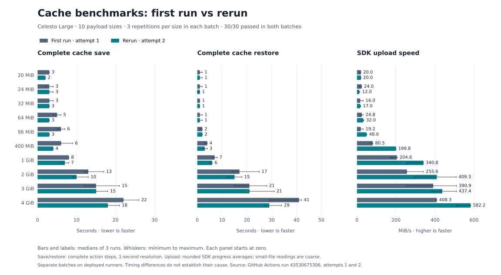

# Cache size matrix rerun: 20 MiB to 4 GiB (attempt 2)

[Benchmark run](https://github.com/CelestoAI/ci-benchmarks/actions/runs/43530675306/attempts/2) · [Workflow](../../.github/workflows/cache-size-matrix.yml) · [Methodology](../../docs/cache-size-matrix.md)

**30/30 save/restore roundtrips passed.** Each of ten payload sizes ran three times sequentially on Celesto Large (4 vCPU, at least 14 GiB usable RAM). Every restore was an exact-key hit and matched the original file size and SHA-256.

## First run vs rerun



Bars show three-run medians; whiskers show the minimum-to-maximum range. Both batches are preserved separately. Save and restore are complete action timings; upload speed is the SDK progress reading.

[PNG](comparison.png) · [SVG](comparison.svg) · [First-run report](../cache-size-matrix-2026-11-14/README.md).

## Results

All times are seconds. Medians use three successful repetitions. Ranges show the fastest and slowest repetition. Roundtrip is the median of each repetition’s save plus restore; generation, hashing, verification, queueing and artifact upload are excluded.

| Payload | Save median (range) | Restore median (range) | Roundtrip median |
| --- | ---: | ---: | ---: |
| 20 MiB | 2 (2–2) | 1 (1–2) | 3 |
| 24 MiB | 3 (3–4) | 1 (0–1) | 4 |
| 32 MiB | 3 (3–3) | 1 (1–1) | 4 |
| 64 MiB | 3 (3–3) | 1 (1–2) | 4 |
| 96 MiB | 3 (3–3) | 2 (2–2) | 5 |
| 400 MiB | 4 (4–4) | 3 (2–4) | 7 |
| 1 GiB | 7 (6–8) | 6 (5–6) | 13 |
| 2 GiB | 10 (9–13) | 15 (12–18) | 27 |
| 3 GiB | 15 (15–18) | 21 (21–31) | 36 |
| 4 GiB | 18 (18–21) | 29 (27–34) | 48 |

## Upload speed and batch duration

This rerun took **14 minutes 54 seconds**, including the results collector. All 30 cases used the original workflow commit `16141e1bd10977c6ca04f7e4e3bec79d31033d12` and fresh attempt-2 cache keys.

Medians below use three successful repetitions per size. Full save includes action startup, archive creation and cache finalization; upload speed is the SDK’s final progress reading with transferred bytes equal to archive bytes. Rounded `100.0%` alone is insufficient to identify completion.

| Payload | Full save median (s) | SDK upload median (MiB/s) | SDK upload range (MiB/s) |
| --- | ---: | ---: | ---: |
| 20 MiB | 2 | 20.0 | 20.0–20.0 |
| 24 MiB | 3 | 12.0 | 8.6–14.6 |
| 32 MiB | 3 | 17.0 | 16.7–18.8 |
| 64 MiB | 3 | 32.0 | 32.0–35.3 |
| 96 MiB | 3 | 48.0 | 48.0–50.4 |
| 400 MiB | 4 | 199.8 | 199.8–199.9 |
| 1 GiB | 7 | 340.8 | 255.4–340.9 |
| 2 GiB | 10 | 409.3 | 294.0–509.0 |
| 3 GiB | 15 | 437.4 | 382.5–510.1 |
| 4 GiB | 18 | 582.2 | 509.7–583.1 |

The SDK computes MiB/s despite labeling the log `MBs/sec`. Its progress clock begins inside the upload operation, after archive creation; readings include upload-operation waiting and progress sampling. Rates are rounded to one decimal with about one-second reporting, especially limiting small-file readings. The 100% line can precede multipart completion and cache finalization. These rates do not measure raw network bandwidth.

[transfer-metrics.json](transfer-metrics.json) preserves all 30 upload and download readings, archive bytes, original completion log lines and inferred progress-clock estimates. Inferred elapsed values divide archive bytes by rounded SDK rates; they are not independently timed upload-completion durations.

## Comparison with the previous batch

[Previous batch](../cache-size-matrix-2026-11-14/README.md). Each cell shows **previous → rerun**. These are separate three-sample batches on deployed runners; changes describe these measurements and do not establish a fleet-wide performance change.

| Payload | Save median (s) | Restore median (s) | SDK upload median (MiB/s) |
| --- | ---: | ---: | ---: |
| 20 MiB | 3 → 2 | 1 → 1 | 20.0 → 20.0 |
| 24 MiB | 3 → 3 | 1 → 1 | 24.0 → 12.0 |
| 32 MiB | 3 → 3 | 1 → 1 | 16.0 → 17.0 |
| 64 MiB | 5 → 3 | 1 → 1 | 24.8 → 32.0 |
| 96 MiB | 6 → 3 | 2 → 2 | 19.2 → 48.0 |
| 400 MiB | 6 → 4 | 4 → 3 | 80.5 → 199.8 |
| 1 GiB | 8 → 7 | 7 → 6 | 204.6 → 340.8 |
| 2 GiB | 13 → 10 | 17 → 15 | 255.6 → 409.3 |
| 3 GiB | 15 → 15 | 21 → 21 | 390.9 → 437.4 |
| 4 GiB | 22 → 18 | 41 → 29 | 408.3 → 582.2 |

CPU models reported by the host fingerprints:

- Previous: Intel(R) Xeon(R) Platinum 8375C CPU @ 2.90GHz: 9 jobs; AMD EPYC-Milan Processor: 21 jobs.
- Rerun: Intel(R) Xeon(R) Platinum 8375C CPU @ 2.90GHz: 8 jobs; AMD EPYC-Milan Processor: 22 jobs.

## Scope and evidence

- Measurements use the deployed runner image and the same pinned `actions/cache` v6.1.0 as the original 4 GiB suite. This run does not install or qualify the adaptive upload patch in [backend PR #1284](https://github.com/CelestoAI/backend/pull/1284).
- Sizes are random payload bytes, not exact compressed archive bytes. Tar/zstd overhead can cross an archive cutoff, including the PR’s 24 MiB boundary.
- GitHub step timings have one-second resolution and include action startup, compression/extraction and transfer. They are not transfer-stage-only timings.
- Jobs were serialized within this workflow. Other workflows and host load can still influence timings. Three repetitions describe this batch, not fleet-wide latency.
- Queue timings in the raw results include intentional matrix serialization; they do not measure provider provisioning latency.
- [results.json](results.json) preserves the collector’s raw phase timings and job status. [jobs.json](jobs.json) preserves the source GitHub Jobs API response; its step timestamps were checked against the collector. [summary.json](summary.json) contains every repetition, original/restored SHA-256 hashes, cache keys, payload bytes and host fingerprints, plus the statistics above.
- Original integrity artifacts and the collector artifact are attached to the benchmark run with up to 14-day retention; a workflow rerun can replace those artifacts. The JSON files here preserve their measurements and integrity evidence beyond that retention period.
- This sweep is separate from the published 4 GiB comparison.

## Validation

- The unchanged workflow definition was validated before the first batch: `actionlint` v1.7.12 passed (custom `celesto-large` label allowed), and `npm test` passed all 4 existing tests with no skips.
- Evidence audit: all 30 expected size/repetition pairs, exact cache hits, payload byte counts, original/restored SHA-256 matches, successful timed phases, and four-CPU host fingerprints passed.

## Regenerate the comparison chart

The chart reads both batches’ saved `summary.json` and `transfer-metrics.json` files. No new benchmark is needed. From the repository root:

```sh
uv run --python 3.12 --with matplotlib==3.10.0 python results/cache-size-matrix-2026-11-14-attempt-2/render-comparison.py
```
