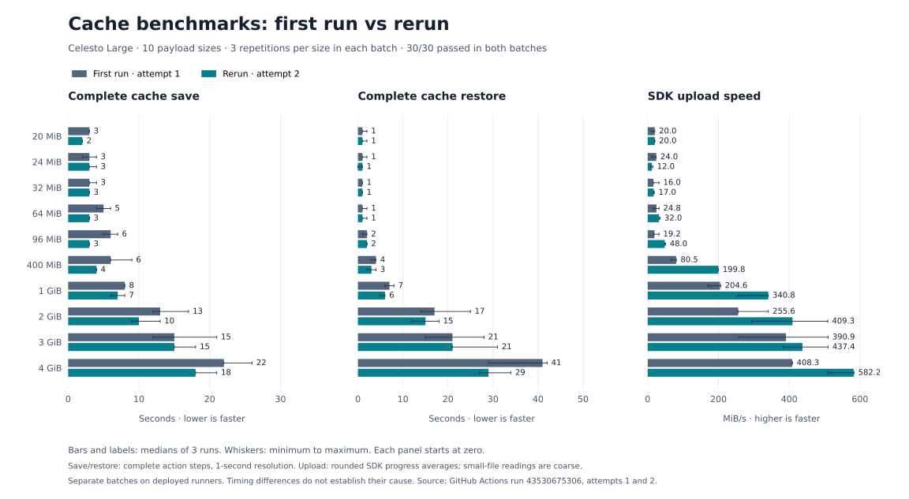

# Cache size matrix: 20 MiB to 4 GiB

[Benchmark run](https://github.com/CelestoAI/ci-benchmarks/actions/runs/43530675306/attempts/1) · [Workflow](../../.github/workflows/cache-size-matrix.yml) · [Methodology](../../docs/cache-size-matrix.md)

**30/30 save/restore roundtrips passed.** Each of ten payload sizes ran three times sequentially on Celesto Large (4 vCPU, at least 14 GiB usable RAM). Every restore was an exact-key hit and matched the original file size and SHA-256.

## First run vs rerun

Bars show three-run medians; whiskers show the minimum-to-maximum range. Both batches are preserved separately. Save and restore are complete action timings; upload speed is the SDK progress reading.

[Rerun report and speed comparison](../cache-size-matrix-2026-11-14-attempt-2/README.md).

## Results

All times are seconds. Medians use three successful repetitions. Ranges show the fastest and slowest repetition. Roundtrip is the median of each repetition’s save plus restore; generation, hashing, verification, queueing and artifact upload are excluded.

| Payload | Save median (range) | Restore median (range) | Roundtrip median |
| --- | ---: | ---: | ---: |
| 20 MiB | 3 (3–3) | 1 (1–2) | 4 |
| 24 MiB | 3 (2–4) | 1 (1–2) | 4 |
| 32 MiB | 3 (3–4) | 1 (1–1) | 4 |
| 64 MiB | 5 (4–6) | 1 (1–2) | 6 |
| 96 MiB | 6 (5–7) | 2 (1–2) | 8 |
| 400 MiB | 6 (6–9) | 4 (3–4) | 10 |
| 1 GiB | 8 (8–8) | 7 (6–8) | 15 |
| 2 GiB | 13 (12–17) | 17 (14–25) | 34 |
| 3 GiB | 15 (12–21) | 21 (15–28) | 42 |
| 4 GiB | 22 (22–26) | 41 (29–42) | 64 |

## Upload speed and batch duration

The complete workflow ran from 2026-11-13 23:55:49 UTC to 2026-11-14 00:11:48 UTC: **15 minutes 59 seconds**, including the results collector. The 30 benchmark jobs occupied a 15 minute 21 second window, including setup, file generation, hashing and artifact uploads.

The table below uses the final 100% `Sent` progress reading for each sample, then takes the median of three readings. Full save is the complete action step from the GitHub Jobs API.

| Payload | Full save median (s) | SDK upload median (MiB/s) | SDK upload range (MiB/s) |
| --- | ---: | ---: | ---: |
| 20 MiB | 3 | 20.0 | 11.7–20.0 |
| 24 MiB | 3 | 24.0 | 12.0–24.0 |
| 32 MiB | 3 | 16.0 | 16.0–32.0 |
| 64 MiB | 5 | 24.8 | 16.0–32.0 |
| 96 MiB | 6 | 19.2 | 16.3–31.9 |
| 400 MiB | 6 | 80.5 | 66.6–81.0 |
| 1 GiB | 8 | 204.6 | 170.5–206.3 |
| 2 GiB | 13 | 255.6 | 255.5–341.1 |
| 3 GiB | 15 | 390.9 | 256.7–510.0 |
| 4 GiB | 22 | 408.3 | 408.1–409.1 |

The SDK reports averages in **MiB/s**, although its log label says `MBs/sec`. Its counter starts inside the upload operation, after archive creation; full save also includes compression, setup and cache finalization. Readings include upload-operation waiting and progress sampling, so they should not be interpreted as raw network bandwidth. The counter updates about once per second and rounds rates to one decimal, which particularly limits small-file readings.

At 4 GiB, the median reported upload rate was **408.3 MiB/s**, compared with a **22-second complete save**. Dividing archive bytes by the rounded rate implies approximately **10 seconds on the SDK progress clock**; that is an inferred estimate, not a separately instrumented upload-completion duration. The completion progress line can appear before multipart completion and cache finalization.

[transfer-metrics.json](transfer-metrics.json) preserves all 30 final upload/download readings, compressed archive byte counts, original log lines and paths, medians and ranges. The rate formula was checked against the [pinned official action bundle](https://github.com/actions/cache/blob/55cc8345863c7cc4c66a329aec7e433d2d1c52a9/dist/save-only/index.js).

## Scope and evidence

- Measurements use the deployed runner image and the same pinned `actions/cache` v6.1.0 as the original 4 GiB suite. This run does not install or qualify the adaptive upload patch in [backend PR #1284](https://github.com/CelestoAI/backend/pull/1284).
- Sizes are random payload bytes, not exact compressed archive bytes. Tar/zstd overhead can cross an archive cutoff, including the PR’s 24 MiB boundary.
- GitHub step timings have one-second resolution and include action startup, compression/extraction and transfer. They are not transfer-stage-only timings.
- Jobs were serialized within this workflow. Other workflows and host load can still influence timings. Three repetitions describe this batch, not fleet-wide latency.
- Queue timings in the raw results include intentional matrix serialization; they do not measure provider provisioning latency.
- [results.json](results.json) preserves the collector’s raw phase timings and job status. [jobs.json](jobs.json) preserves the source GitHub Jobs API response; its step timestamps were checked against the collector. [summary.json](summary.json) contains every repetition, original/restored SHA-256 hashes, cache keys, payload bytes and host fingerprints, plus the statistics above.
- Attempt 1’s original integrity and collector artifacts were replaced when the full workflow was rerun as attempt 2. The JSON files here preserve the first batch’s measurements, hashes and host fingerprints independently of GitHub artifact retention. Original action logs are under the linked attempt-1 run.
- This sweep is separate from the published 4 GiB comparison.

## Validation

- Workflow lint: `actionlint` v1.7.12 passed (custom `celesto-large` label allowed).
- Existing repository checks: `npm test`, 4 passed, 0 skipped.
- Evidence audit: all 30 expected size/repetition pairs, exact cache hits, payload byte counts, original/restored SHA-256 matches, successful timed phases, and four-CPU host fingerprints passed.
