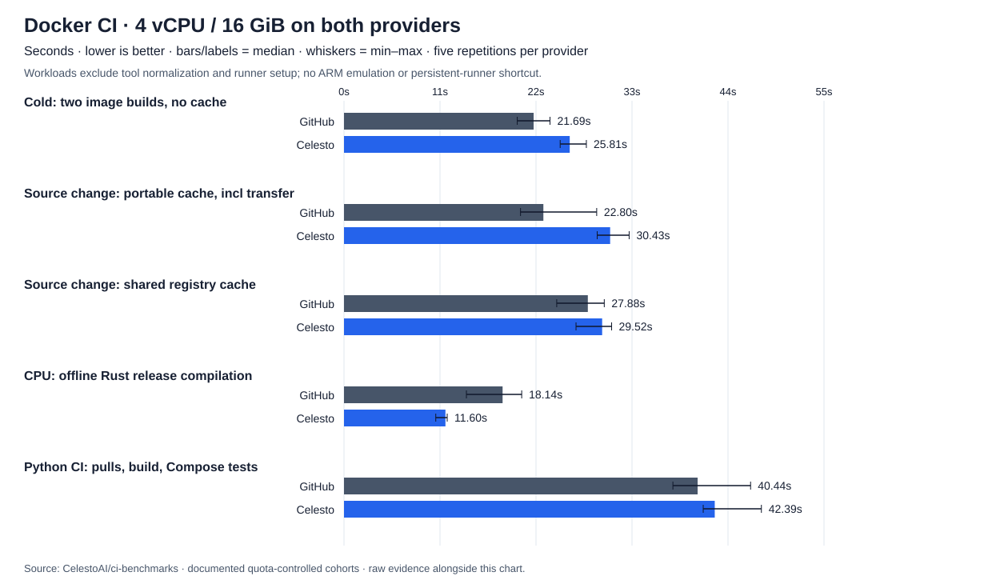

# Docker CI benchmark results

**120 successful authenticated jobs; five repetitions per provider/scenario.** Workload bytes are unchanged across revisions. Earlier quota and anonymous-pull failures remain in diagnostics below; none are pooled into these timings.

Both providers: **4 vCPU, 16 GiB nominal RAM, Ubuntu 24.04, x86-64**. Pinned Docker/BuildKit/tool versions and workloads; fresh runner for every cache scenario.

| Observed environment | GitHub | Celesto |
| --- | --- | --- |
| CPU model(s) | AMD EPYC 9V74 80-Core Processor, AMD EPYC 9V45 96-Core Processor, AMD EPYC 7763 64-Core Processor, Intel(R) Xeon(R) Platinum 8370C CPU @ 2.80GHz, Intel(R) Xeon(R) 6973P-C, INTEL(R) XEON(R) PLATINUM 8573C | AMD EPYC-Milan Processor, Intel(R) Xeon(R) 6975P-C |
| Kernel(s) | 6.17.0-1022-azure | 6.12.85 |
| containerd build(s) | v2.4.1 | 2.2.1 |

Resource counts match; physical CPU models, kernels, and distribution builds do not. [Environment counts](environment-summary.json).

**Known Celesto limits:** direct BuildKit `type=gha,version=2` export and Docker's explicit `--cpus` flag failed preflight. Results below use clearly labeled registry/portable caching and the VM's existing CPU allocation. These are not claims that those compatibility issues are fixed.

## Main results

Seconds: **median (observed min–max; sample count)**. These are workload times, not queue-to-result times.

| Workload | GitHub | Celesto | GitHub / Celesto time |
| --- | ---: | ---: | ---: |
| Cold: two image builds, no cache | 21.69 (19.81–23.56; n=5) | 25.81 (24.72–27.71; n=5) | 0.84× |
| Source change: portable cache, incl transfer | 22.80 (20.18–28.89; n=5) | 30.43 (28.96–32.61; n=5) | 0.75× |
| Source change: shared registry cache | 27.88 (24.32–29.76; n=5) | 29.52 (26.53–30.60; n=5) | 0.94× |
| CPU: offline Rust release compilation | 18.14 (14.00–20.32; n=5) | 11.60 (10.49–11.80; n=5) | 1.56× |
| Python CI: pulls, build, Compose tests | 40.44 (37.61–46.49; n=5) | 42.39 (41.08–47.73; n=5) | 0.95× |

A ratio above 1 means Celesto was faster; below 1 means GitHub was faster. Five samples describe this run, not a universal speedup or a confidence interval. Generated fixtures are not the prospect's exact workflow.

## Cache scenario totals

Both images together, including correctness checks and any sequential outer cache restore/save.

| Cache backend | Scenario | GitHub | Celesto |
| --- | --- | ---: | ---: |
| portable | seed | 27.53 (25.96–30.29; n=5) | 35.87 (28.97–40.17; n=5) |
| portable | unchanged | 22.44 (17.98–22.91; n=5) | 31.09 (26.65–35.75; n=5) |
| portable | source | 22.80 (20.18–28.89; n=5) | 30.43 (28.96–32.61; n=5) |
| portable | dependency | 29.60 (29.47–34.85; n=5) | 38.41 (33.20–42.73; n=5) |
| registry | seed | 48.70 (42.86–50.36; n=5) | 47.95 (46.62–48.97; n=5) |
| registry | unchanged | 13.48 (12.47–18.92; n=5) | 17.65 (15.45–20.23; n=5) |
| registry | source | 27.88 (24.32–29.76; n=5) | 29.52 (26.53–30.60; n=5) |
| registry | dependency | 48.12 (41.91–50.37; n=5) | 46.89 (44.68–47.81; n=5) |

Portable = BuildKit layer export transferred through each provider's actions/cache endpoint. Registry = identical GHCR cache backend on both providers. BuildKit vertex durations can overlap and are not added to produce these totals.

A cache hit is not automatically a speedup: transfer, import, and export can cost more than rebuilding these small fixtures. Compare complete workload times, not hit counts alone.

Dependency-install layer hits in expected-reuse cases: **80/80** across both apps/providers/backends. Cold/dependency-change installs are independently checked to execute. This is a layer-hit count, not a byte-weighted cache hit ratio. Exact archive restores: **40/40** (30 portable layer-cache restores + 10 image-tar restores), verified independently from raw events.

Expected install executions after cold/dependency-change/no-cache builds: **100/100**. A dependency-lock change must invalidate the install layer; counting every job as a hit would be incorrect.

## Portable cache transfer

The two image caches together; outer actions/cache boundaries include compression/extraction and action overhead, not just network transfer.

| Scenario | Operation | GitHub | Celesto |
| --- | --- | ---: | ---: |
| seed | save | 2.17 (1.31–2.49; n=5) | 3.54 (3.20–4.00; n=5) |
| unchanged | restore | 2.44 (1.41–3.44; n=5) | 2.86 (2.70–7.81; n=5) |
| unchanged | save | 1.99 (1.64–3.04; n=5) | 3.30 (3.18–6.19; n=5) |
| source | restore | 2.02 (1.49–4.62; n=5) | 2.82 (2.24–4.89; n=5) |
| source | save | 2.38 (1.56–2.52; n=5) | 3.69 (3.05–4.53; n=5) |
| dependency | restore | 1.47 (1.36–3.77; n=5) | 2.73 (2.29–4.69; n=5) |
| dependency | save | 1.93 (1.54–3.11; n=5) | 3.31 (2.62–4.27; n=5) |

Save times are included only when the save succeeded; a warning from a green Actions job is not a successful save.

Celesto's committed portable archives were **173.0–173.2 MiB compressed** per save (both apps together), verified against committed cache entries. These are dependency/build caches, not the separate 512-MiB random-byte benchmark.

## Image pull versus tar cache

PostgreSQL + Azurite, together. Cache restore alone is not enough: docker load must finish too.

| Operation | GitHub | Celesto |
| --- | ---: | ---: |
| two images: direct pull | 7.49 (6.55–8.33; n=5) | 8.72 (8.29–9.57; n=5) |
| two images: cache save | 2.85 (2.03–3.08; n=5) | 4.54 (3.16–7.61; n=5) |
| two images: cache restore | 1.56 (1.23–2.90; n=5) | 3.28 (2.82–8.74; n=5) |
| two images: cache restore + docker load | 8.14 (7.20–9.75; n=5) | 12.18 (11.72–17.60; n=5) |

In this fixture, median restore + Docker load was slower than direct pull on both providers. This does not establish the outcome for larger images or other registries.

## Compatibility caveat

Direct BuildKit `type=gha,version=2` crashed on Celesto in both preflight attempts (2/2); GitHub passed both. Registry and portable caching are separate paths, not evidence that direct GHA cache compatibility is fixed. See [protocol reproduction](https://github.com/CelestoAI/ci-benchmarks/actions/runs/39073026017) and [methodology](../../docker-bench/README.md). No failed pilot is pooled into the five-repeat results.

## Completeness and evidence

- Failed/incomplete artifacts in the selected matrix: **0**. See [failure inventory](failures.json); missing measurements are never zero.
- [Every measured sample, CSV](samples.csv) · [JSON](samples.json) · [aggregated medians/ranges](summary.json).
- [Cache hit observations](cache-observations.json) · [job timestamps and links](run.json) · [raw logs/events](raw/).
- [Exact fixtures, controls, limitations, and reproduction commands](../../docker-bench/README.md) · [compatibility evidence](../../docker-bench/compatibility.md).

Tool normalization and post-cleanup are excluded from workload comparisons; full Actions job duration is retained as a separate metric. Cold means no reusable build cache, not a globally empty registry/CDN. CPU measurements disable network only for compilation; image pulls and dependency fetch are separate. No private code, production deployments, or customer messages were involved.

[Machine-readable cohort manifest](cohort-manifest.json) · [registry quota observations](registry-quota-observations.json). The quota probe uses HEAD, runs outside workload timing, and never records credentials or client IPs.

## Interventions and cohort provenance

The [original run](https://github.com/CelestoAI/ci-benchmarks/actions/runs/39073691950) filled Celesto’s cache quota. Two saves warned despite green jobs; three later exact restores missed. This is a service limitation, not a zero-second save or a successful cache result. [Original failures](diagnostics/original-quota-run/failures.json), [save warnings](diagnostics/original-quota-run/cache-warnings.json), and [raw evidence](diagnostics/original-quota-run/raw/) are preserved.

The [unauthenticated continuation](https://github.com/CelestoAI/ci-benchmarks/actions/runs/39075713994) then hit Docker Hub’s anonymous pull limit on Celesto: 9/10 uncached jobs passed, one returned HTTP 429, and the runtime phase was skipped. [Failure and raw evidence](diagnostics/unauthenticated-rate-limit-run/). This is an operational finding, not a timing sample.

**Every one of the 120 selected jobs was rerun with Docker Hub login on both providers**, including the registry cohort that had previously passed. No earlier successful sample or failed attempt is pooled into these timings. Registry locations and pinned image digests were not changed. Login/setup time is excluded from workload measurements and retained in full job durations.

Credential setup attempts failed before measurements; one token-capture attempt accidentally appended adjacent UI labels. That capture was corrected. [Direct Docker Hub and Docker CLI authentication then passed on both providers](https://github.com/CelestoAI/ci-benchmarks/actions/runs/39078014200). [Setup-run metadata](diagnostics/authentication-setup.json) is kept separate from runner performance. No secret values are included.

With explicit approval, we removed only 18 task-owned Docker pilot/benchmark caches (3.07 GiB), leaving original CPU/tooling/unrelated caches and quotas unchanged. At most two paired experiments ran at once (four jobs total). Each portable pair’s four Celesto saves were verified committed before removing its completed caches. This measures normal operation with available quota, **not cache retention under storage pressure**. See [intervention receipt](interventions.json).

Docker Hub’s live headers reported a shared account allowance of **200 pulls per 3,600 seconds** in this experiment. Before starting further cohorts, non-pulling HEAD probes checked available allowance; dispatch waited when its conservative budget would not fit. These are between-cohort waits, not measured build/cache speed, and do not establish queue-to-result performance. [Probe runs and wait timestamps](cohort-manifest.json) are preserved. No account upgrade, registry substitution, or quota increase was used.

Local orchestration also stopped once on a GitHub API connection error during a quota probe, then resumed from the saved cohort journal without duplicating completed benchmarks. Log collection encountered a connection reset and was retried against the same completed runs. The dispatch gap is not wholly a quota wait; neither interruption is included in workload timings.

| Cohort | Run | Selected jobs | Whole-run status |
| --- | --- | ---: | --- |
| continuation | [39078068661](https://github.com/CelestoAI/ci-benchmarks/actions/runs/39078068661) | 20 | success |
| portable-pair 1 | [39078729403](https://github.com/CelestoAI/ci-benchmarks/actions/runs/39078729403) | 8 | success |
| registry-pair 1 | [39078738654](https://github.com/CelestoAI/ci-benchmarks/actions/runs/39078738654) | 8 | success |
| portable-pair 2 | [39079182412](https://github.com/CelestoAI/ci-benchmarks/actions/runs/39079182412) | 8 | success |
| registry-pair 2 | [39079233429](https://github.com/CelestoAI/ci-benchmarks/actions/runs/39079233429) | 8 | success |
| portable-pair 3 | [39081924554](https://github.com/CelestoAI/ci-benchmarks/actions/runs/39081924554) | 8 | success |
| registry-pair 3 | [39081977281](https://github.com/CelestoAI/ci-benchmarks/actions/runs/39081977281) | 8 | success |
| portable-pair 4 | [39082292982](https://github.com/CelestoAI/ci-benchmarks/actions/runs/39082292982) | 8 | success |
| registry-pair 4 | [39082373652](https://github.com/CelestoAI/ci-benchmarks/actions/runs/39082373652) | 8 | success |
| portable-pair 5 | [39082713916](https://github.com/CelestoAI/ci-benchmarks/actions/runs/39082713916) | 8 | success |
| registry-pair 5 | [39082805485](https://github.com/CelestoAI/ci-benchmarks/actions/runs/39082805485) | 8 | success |
| image-full | [39083202858](https://github.com/CelestoAI/ci-benchmarks/actions/runs/39083202858) | 20 | success |

CPU/RAM counts and named Docker/Buildx/Compose/BuildKit versions match, not physical CPUs, storage, network location, kernels, or host runtime binaries. Celesto's Ubuntu Docker build and GitHub's upstream Docker bundle have different supporting containerd packages. Full versions are in raw logs. Cohorts ran in different time windows; five samples cannot remove host or network variability.

[Independent validation receipt](validation.json): expected matrix coverage, sample counts, log checksums, layer-hit outcomes, and separately recomputed medians/ranges/ratios.
