# Runner comparison

Updated 2026-11-11. All runners: 4 vCPU, x64. Each bar is a median.

- **Celesto:** this repository's [runner suites](../../docs/suites.md), latest run of each suite (3 jobs; 15 for burst).
- **Other providers:** [runs-on.com public benchmark data](https://github.com/runs-on-demo/benchmark-public) from the last 30 days. Same workloads and settings; measured by runs-on.com on their accounts.

## Rust

Celesto run: 2026-11-11.

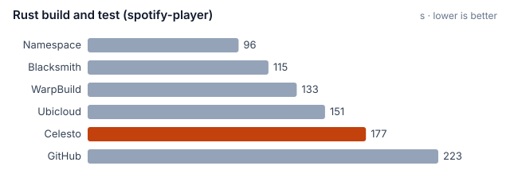

Jobs: Celesto 3, GitHub 10, Blacksmith 10, Namespace 10, WarpBuild 10, Ubicloud 10.

## Node

Celesto run: 2026-11-11.

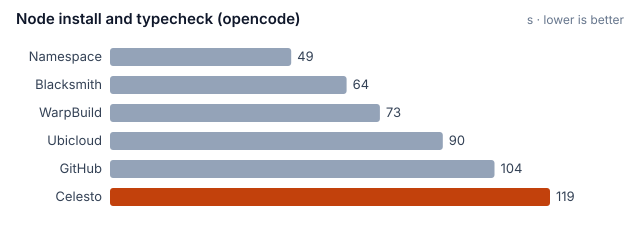

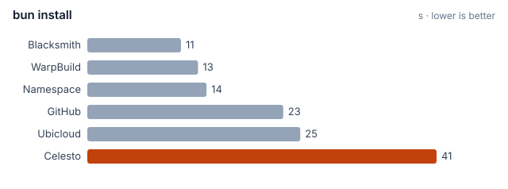

Jobs: Celesto 3, GitHub 13, Blacksmith 13, Namespace 13, WarpBuild 13, Ubicloud 13.

## Docker

Celesto run: 2026-11-11.

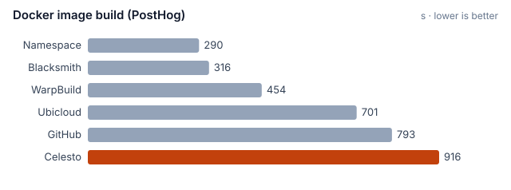

Jobs: Celesto 2, GitHub 11, Blacksmith 11, Namespace 10, WarpBuild 10, Ubicloud 11.

## Cache

Celesto run: 2026-11-11.

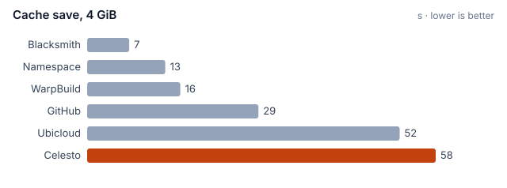

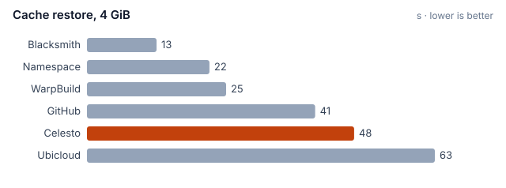

Jobs: Celesto 3, GitHub 10, Blacksmith 10, Namespace 10, WarpBuild 10, Ubicloud 10.

## Burst

Celesto run: 2026-11-11.

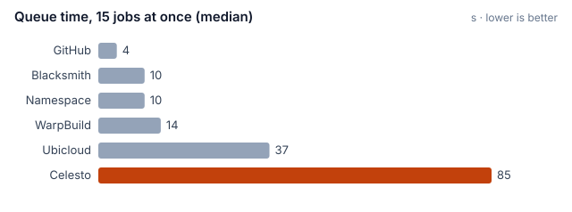

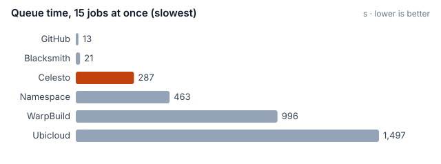

Jobs: Celesto 15, GitHub 120, Blacksmith 120, Namespace 120, WarpBuild 120, Ubicloud 120.

## Hardware

Celesto run: 2026-11-11.

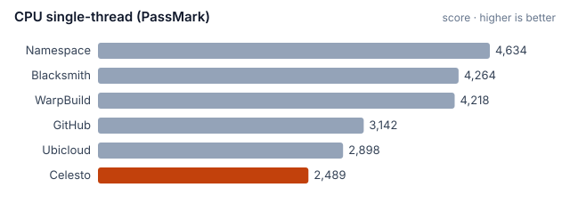

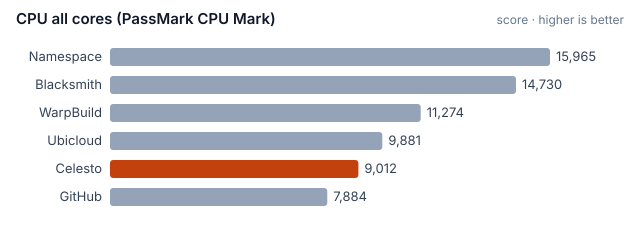

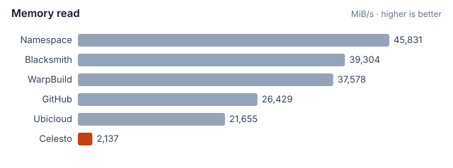

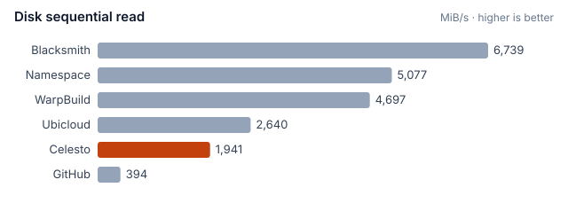

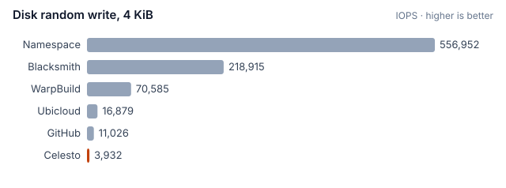

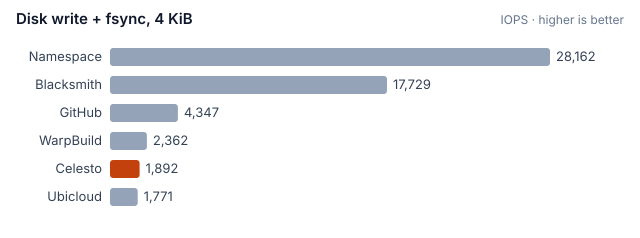

Jobs: Celesto 3, GitHub 10, Blacksmith 10, Namespace 10, WarpBuild 10, Ubicloud 10.
